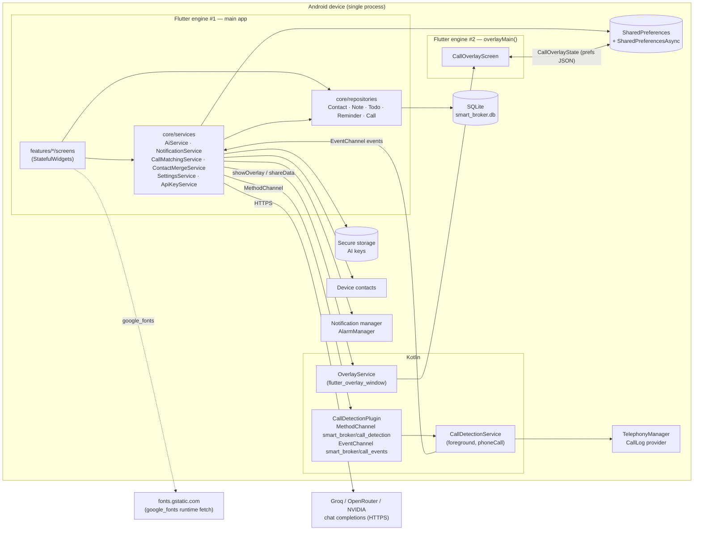
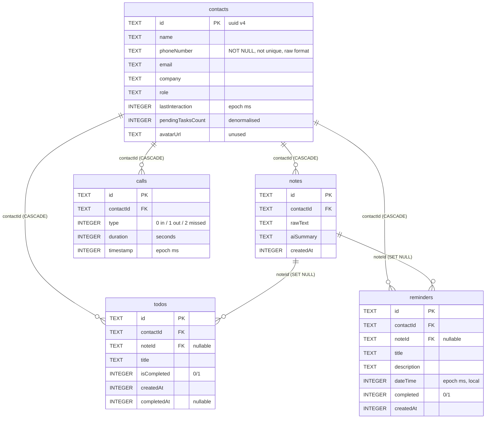

# 01 — Current-state report

Review date: 2026-09-28 · Reviewed revision: working tree at commit `3c9ca74` **plus 35 uncommitted files** (see §10 and F-009). All `file:line` references are to the working tree as reviewed.

Confidence tags: **[Verified]** read/ran it · **[Inferred]** strongly implied · **[Assumed]** gap-filling assumption.

---

## 1. Executive summary

SmartBroker is a Flutter (Dart 3.11 / Flutter ≥3.38.4) Android-first personal CRM for a broker: contacts → notes → LLM extraction of summary/tasks/reminders → local notifications, plus a native Kotlin foreground service that detects phone calls, logs them against contacts and shows a floating "call notes" overlay. It is **single-user, offline-first, no backend**: all data lives in an on-device SQLite database (5 tables), settings in SharedPreferences, the AI key in secure storage. ~10.3k lines of Dart/Kotlin across 44 Dart files, 2 Kotlin files, 2 test files (25 tests). Three commits in git history; the bulk of the app was written between May and July 2026 and a large batch of changes (AI provider switch, overlay rework, bug fixes) is sitting uncommitted and uncompiled in the working tree. **Maturity: late prototype / pre-alpha.** It runs on a real Samsung device (the user's log shows `CallMatchingService` processing a simulated call), but the call-overlay path has never been exercised end-to-end.

**Top 5 strengths** [Verified]
1. Clean, consistent layering: `models/` → `core/repositories/` (one per table, parameterised queries) → `core/services/` → `features/*/screens/`.
2. Small, readable domain model with `toMap/fromMap/copyWith` everywhere and FK cascades in the schema (`lib/core/database/database_helper.dart:37-105`).
3. AI integration is provider-agnostic (`lib/core/services/ai_provider.dart`), uses strict JSON schema where supported, and degrades gracefully (`ai_service.dart:275-282`).
4. Native call detection is done properly for both API levels (`TelephonyCallback` ≥31, `PhoneStateListener` below) and runs as a typed foreground service (`CallDetectionService.kt:118-146`).
5. Thoughtful UX details already exist: undo-delete snackbars, overdue accents, empty states, draft auto-save in the overlay.

**Top 5 risks** [Verified unless noted]
1. **Data loss path:** re-running AI Review on an existing note deletes *all* linked tasks (completed ones included) with no transaction (`ai_review_screen.dart:267-274`) — F-001.
2. **No way to keep a note if the AI call fails** (offline, no key, rate-limited) — the only exit is "Retry" or discard (`add_note_screen.dart:95-103`, `ai_review_screen.dart:169-177`) — F-003.
3. **Fragile startup:** `main()` awaits DB seeding, timezone lookup and notification init with no error handling before `runApp` (`lib/main.dart:26-42`) — any throw = permanent blank screen — F-002.
4. **Distribution/policy:** `READ_CALL_LOG`, `READ_PHONE_STATE`, `SYSTEM_ALERT_WINDOW` (`AndroidManifest.xml:11-18`) are Play-restricted permissions; the release build is signed with debug keys (`build.gradle.kts:35-39`) — F-006, F-008 [Inferred for policy].
5. **Verification gap:** 35 modified files (Kotlin, manifest, Dart) are uncommitted and have not been through `flutter analyze`/`flutter test`; there is no CI and test coverage is ~3 files — F-009, F-018.

**Health ratings (1–10)**

| Area | Score | One-line justification |
|---|---|---|
| Architecture | 5 | Good layering and naming, but no state layer: every screen re-queries the DB on every `pop` and lists go stale (F-017). |
| Code quality | 6 | Idiomatic Dart, consistent style, `flutter_lints` on; a handful of async/`mounted` and disposal slips (F-022, F-027). |
| Security & privacy | 5 | Key in secure storage, parameterised SQL; but client data sent to a third-party LLM without consent, sensitive `debugPrint`s in release, debug signing (F-005, F-006). |
| Test coverage | 2 | 25 unit tests on 3 pure files; zero repository/widget/native tests; no CI (F-018). |
| Performance | 6 | Dataset is tiny; only real costs are full phonebook reads per Contacts load and runtime font download (F-015, F-016). |
| Dev experience | 4 | `flutter run` works on Windows, but no CI, no scripts, no lint gate, 8 GB Gradle heap requirement, uncommitted work (F-009, F-033). |
| Production readiness | 3 | Debug signing, generic label, demo data seeded into real DB, policy-restricted permissions, unverified overlay (F-006, F-008, F-010). |

---

## 2. Tech stack

| Layer | Technology | Version (lockfile) | Notes |
|---|---|---|---|
| Framework | Flutter (stable) | ≥3.38.4 (`pubspec.lock` sdks; `.metadata` rev `ff37bef6…`) | Material 3. |
| Language | Dart | ≥3.11.1 <4.0.0 | Dart 3 records/switch expressions used (`call_event.dart:20`). |
| Native Android | Kotlin / AGP / Gradle | Kotlin 2.2.20, AGP 8.11.1, Gradle 8.14, JVM 17 (`android/settings.gradle.kts`, `gradle-wrapper.properties`) | `org.gradle.jvmargs=-Xmx8G` (`gradle.properties:1`) is unusually high (F-033). Core-library desugaring enabled. |
| Storage | sqflite | 2.4.2+1 | Schema v1, no migrations/indexes (F-011). |
| Settings | shared_preferences | 2.5.5 | Both legacy `SharedPreferences` (settings) and `SharedPreferencesAsync` (overlay state) are used — two backends (F-033). |
| Secrets | flutter_secure_storage | 9.2.4 | One key per AI provider (`api_key_service.dart`). |
| AI | `http` → OpenAI-compatible chat completions (Groq default) | http 1.6.0 | Providers: Groq (`openai/gpt-oss-20b`), OpenRouter, NVIDIA NIM (`ai_provider.dart:31-57`). |
| Notifications | flutter_local_notifications + timezone + flutter_timezone | 22.1.0 / 0.11.1 / 5.1.0 | Exact-alarm permission handling present. |
| Contacts | flutter_contacts | 2.1.0 | Read-only, phones only. |
| Overlay | flutter_overlay_window | 0.5.0 (Apr 2025) | Low-maintenance package; second Flutter engine in-process; px/dp units inconsistent in its API [Verified via package source read by sub-agent]. |
| Calendar | table_calendar | 3.2.0 | |
| Icons/fonts | lucide_icons 0.257.0, google_fonts 8.1.0 | | `lucide_icons` is an unmaintained fork line [Inferred]; google_fonts downloads at runtime (F-015). |
| IDs | uuid | 4.6.0 | |
| Lint | flutter_lints | 6.0.0 | Default rule set only (`analysis_options.yaml`). |
| Tests | flutter_test | sdk | No `sqflite_common_ffi`, no mocking lib. |
| CI/CD | — | — | None (`.github/` absent). |
| Other targets | ios/, web/, linux/, macos/, windows/ | scaffolding | Not runnable: `dart:io Platform` in `main.dart:1`, `settings_screen.dart:4`; sqflite has no desktop/web impl (F-030). |

Dependency audit: **not run** — no Dart SDK is reachable from the review environment and network to `storage.googleapis.com` is blocked (see §10). Manual check of the lockfile found no package at a known-vulnerable version [Inferred].

---

## 3. Architecture diagram



Architectural style [Verified]: **layered modular monolith inside a mobile app**. Presentation = `StatefulWidget` screens with local state; Domain/data = repositories over sqflite; Integration = services (singletons via factory constructors). No DI container, no state-management library, no event bus — screens refresh by calling `_loadData()` after every `Navigator.push(...).then(...)` (e.g. `home_screen.dart:190`). Consistency is good within layers; the exception is that services occasionally reach into repositories that a screen also holds (e.g. `CallMatchingService` constructs `TodoRepository()`/`NoteRepository()` inline at `call_matching_service.dart:230-231`).

Background work: one Android foreground service (`CallDetectionService`), one flutter_overlay_window service, `flutter_local_notifications` scheduled alarms + boot receiver (`AndroidManifest.xml:50-56`). No queues, no cron, no webhooks.

---

## 4. Module map

| Path | Responsibility | Key files | Depends on | Health notes |
|---|---|---|---|---|
| `lib/main.dart` | App entry, route table, overlay entry point `overlayMain`, startup restore of call detection, pending-AI-review handoff | `main.dart` (132 lines) | services, screens | No error boundary around startup awaits (F-002). |
| `lib/core/constants/` | Route names + global navigator key | `app_routes.dart` | — | Fine. |
| `lib/core/database/` | `DatabaseHelper` (schema v1, FK on), `SeedData` (mock → DB on first run) | `database_helper.dart`, `seed_data.dart` | `mock/`, repositories | No migrations/indexes (F-011); seeds prod DB (F-010). |
| `lib/core/repositories/` | CRUD per table; `TodoRepository` maintains `contacts.pendingTasksCount` | 5 files | `DatabaseHelper`, models | Parameterised queries throughout; `TodoRepository.getAll` assembles SQL from internal constants (`todo_repository.dart:15-41`). No transactions. |
| `lib/core/services/` | AI (`AiService`, `AiProvider`, `AiResponseParser`, `ApiKeyService`), settings, notifications, contacts merge, call detection bridge, call matching/overlay orchestration, overlay shared state & drafts | 13 files | http, plugins, repositories | Largest and most changed area; `call_matching_service.dart` (310 lines) is the orchestration hub. Debug logging of PII (F-005). |
| `lib/core/theme/` | `AppColors`, `AppSpacing`, `AppRadius`, `AppTheme.lightTheme` | `app_theme.dart` | google_fonts | Light theme only; runtime font fetch (F-015). |
| `lib/core/widgets/` | Reusable cards/tiles/headers/empty states | 7 files | theme, models | `TodoTile` tap toggles completion (F-023); `ReminderCard` accepts `onTap/onComplete` but callers omit them. |
| `lib/features/home/` | `MainShell` (4-tab `IndexedStack` + glass nav) and dashboard | `main_shell.dart`, `home_screen.dart` | repos, widgets | Hardcoded user name (F-028); a11y on nav items (F-031). |
| `lib/features/contacts/` | Merged contact list with filters/search, contact detail (notes/tasks/calls/reminders), phone-only contact promotion | 3 screens (1,323 lines) | `ContactMergeService`, repos | Dead "Add contact" and "⋯" buttons (F-019); no CRUD. |
| `lib/features/notes/` | Add note, AI review (extraction + save), note detail (edit/delete), notes list (search, grouped) | 4 screens | AI service, repos, notifications | Notes list unreachable (F-019); AI-only save path (F-003); destructive re-review (F-001). |
| `lib/features/todos/` | All-tasks screen: filters, sort, bulk actions, undo delete, add sheet | `tasks_screen.dart` | `TodoRepository` | No due dates (F-020). |
| `lib/features/calendar/` | Month/week calendar of reminders, add sheet, reminder detail with edit/complete/delete | 2 screens (1,220 lines) | `ReminderRepository`, `NotificationService` | Past-time reminders accepted (F-004); range mismatch 2030 vs 2100 (F-026). |
| `lib/features/calls/` | Floating call overlay UI (briefing → active notes → ended) | `call_overlay_screen.dart` | `CallOverlayState`, `OverlayDraftService` | Runs in engine #2; unverified on device (F-009). |
| `lib/features/settings/` | AI provider/key/model, call detection & overlay toggles, simulate call, placeholders | `settings_screen.dart` (582 lines) | most services | 4 inert tiles (F-019). |
| `lib/mock/` | 8 contacts, 4 notes, 7 todos, 5 reminders, 6 calls | 5 files | models | Contains a real-looking name/email/phone (`mock_contacts.dart:4-13`) (F-010). |
| `lib/models/` | Plain immutable models + DTOs (`CallEvent`, `UnifiedContact`, `NoteWithContact`, `TodoWithContact`, `AiResult`, `PhoneContact` incl. number normalisation) | 11 files | — | Good; `initials` getters hardened this session. |
| `test/` | Unit tests: `CallEvent`/`CallEntry`/`PhoneContact` (19), `AiResponseParser` (6) | 2 files | flutter_test | No DB/widget/native tests (F-018). |
| `android/` | Gradle build, manifest, Kotlin plugin + foreground service, launcher icons | `app/build.gradle.kts`, `AndroidManifest.xml`, 3 `.kt` | Flutter Gradle plugin | Debug signing for release (F-006); restricted permissions (F-008); events dropped when Dart not listening (F-007). |
| `ios/` | Xcode runner, `Info.plist` with `NSContactsUsageDescription` only | generated | — | Never built [Inferred]; call features are Android-only by design. |
| `web/`, `linux/`, `macos/`, `windows/` | Default Flutter scaffolding | generated | — | Not runnable with current code (F-030). |
| Root | `README.md` (rewritten this session, accurate), `pubspec.yaml`, `analysis_options.yaml`, `.gitignore`, `.metadata`, `smart_broker.iml` | | | `.flutter-plugins-dependencies` is ignored and untracked ✓. No `CLAUDE.md`/`AGENTS.md`/`CONTRIBUTING`/`CHANGELOG`/`docs/` before this review. |

---

## 5. Data model



Source: `lib/core/database/database_helper.dart:37-105` [Verified]. `PRAGMA foreign_keys = ON` at open (`:25-26`).

| Entity | Notable issues |
|---|---|
| contacts | No unique key on phone → duplicates (F-012). `phoneNumber` stored raw; matching uses last-9-digit key computed at runtime (`phone_contact.dart:33-41`) so there is no indexed lookup. `pendingTasksCount` is maintained only by `TodoRepository` and is overwritten by any full-row `update()` (F-013). `avatarUrl` never populated. |
| notes | Fine. Delete leaves todos/reminders orphaned-but-valid (SET NULL) — intended (`contact_detail_screen.dart:505-507`). |
| todos | No due date (F-020). `completedAt` cleared on reopen. |
| reminders | Stored as local epoch; notification converts with `tz.TZDateTime.from(reminder.dateTime, tz.local)` (`notification_service.dart`, ≈`:159`) — consistent. Past `dateTime` accepted (F-004). |
| calls | No unique key on (contactId, timestamp) → the same call can be logged twice if the native dedup state resets (F-024). |
| Off-DB state | `SharedPreferences`: settings (`settings_service.dart`). `SharedPreferencesAsync`: `call_overlay_state`, `pending_ai_review`, `overlay_draft_<id>`. Secure storage: `ai_key_<provider>` (+ legacy `nvidia_api_key`). |
| Migrations | `version: 1`, `_onUpgrade` empty (`database_helper.dart:22,106-108`). No indexes at all. |
| Seed | `SeedData.seedIfNeeded` inserts all mock data when `contacts` is empty (`seed_data.dart:14-19`) — runs in release too (F-010). |

---

## 6. Feature inventory

Status legend: **Complete** works as designed · **Partial** works with gaps · **Broken** verified defect blocks normal use · **Stub** UI only · **Dead** unreachable/unused.

| Feature | User-facing description | Status | Key files | Tests | Evidence |
|---|---|---|---|---|---|
| Home dashboard | Greeting, stat pills, open reminders, recent contacts, pending tasks | Partial | `home_screen.dart` | none | Hardcoded name `:118`; tapping a task toggles it `:200-208`. |
| Contact list + filters + search | Merged SmartBroker + phonebook, All/Recent/Has Tasks/Overdue, pull-to-refresh | Complete | `contacts_screen.dart`, `contact_merge_service.dart` | none | Overdue fixed this session (`:58-59`). Search is substring on raw number `:86-89`. |
| Add phonebook contact to CRM | "Add to SmartBroker" on phone-only contact | Partial | `phone_contact_detail_screen.dart:36-61` | none | No duplicate check; list stale after `popAndPushNamed`. |
| Create/edit/delete contact | Manual contact management | Stub | `contacts_screen.dart:155`, `contact_detail_screen.dart:140` | none | Both handlers are `() {}`. |
| Contact detail | Header, notes timeline, tasks (add/edit/toggle/delete+undo), call history, reminders | Partial | `contact_detail_screen.dart` | none | Reminder cards inert `:749`; "0m" durations fixed this session. |
| Add note → AI review → save | Write note, AI proposes summary/tasks/reminder, edit, save | Partial | `add_note_screen.dart`, `ai_review_screen.dart`, `ai_service.dart` | parser only | No save without AI (F-003); re-review deletes tasks (F-001); works on device per user screenshot [Verified from user-provided screenshot]. |
| Note detail (edit/delete) | Edit raw text & summary, re-run AI, delete | Complete | `note_detail_screen.dart` | none | `setState` after await without guard `:122`. |
| Notes list (search, grouped by date) | All notes across contacts | Dead | `notes_list_screen.dart`, route table `main.dart:117-128` | none | No `pushNamed(AppRoutes.notesList)` anywhere (grep). |
| Tasks screen | Filters, sort, bulk complete/delete, undo, add | Complete | `tasks_screen.dart` | none | Bulk-complete fixed this session `:96-98`. |
| Calendar + reminders | Month/week view, add sheet, detail/edit/complete/delete, notifications | Partial | `calendar_screen.dart`, `reminder_detail_screen.dart`, `notification_service.dart` | none | Past-time acceptance (F-004); range mismatch (F-026). |
| Reminder notifications | Exact/inexact local alarms, reschedule on boot & launch | Partial | `notification_service.dart` | none | `cancelAll` on launch (F-014). |
| Settings — AI | Provider picker, key validation, model override | Complete (uncompiled) | `settings_screen.dart:52-150` | none | Changed this session, not yet built (F-009). |
| Settings — call detection & overlay | Permissions, toggles, min duration, overlay permission | Partial | `settings_screen.dart:153-200,395-530` | none | Depends on native changes not yet built. |
| Settings — Theme / Clear AI cache / Debug menu / Reset data | | Stub | `settings_screen.dart:302,400,538,552` | none | `onTap: () {}`. |
| Call detection (native) | Foreground service, call-state events, call-log read on hang-up | Partial | `CallDetectionService.kt`, `CallDetectionPlugin.kt`, `call_detection_service.dart` | DTO parsing only | Events dropped when Dart not attached (F-007); log heuristic (F-024). |
| Call matching + auto-log + post-call prompt | Match number → contact (or create), insert call, notification "Tap to add a note" | Partial | `call_matching_service.dart:252-308` | none | Auto-creates unknown numbers (F-021). User log confirms path works for simulated call [Verified]. |
| Live call overlay | Floating window: briefing while ringing, notes while active, Save & Process | Partial (unverified) | `call_overlay_screen.dart`, `call_overlay_state.dart`, `main.dart:47-55` | none | Rewritten this session; never run on device (F-009). |
| Simulate call (dev tool) | Plays ringing → active → ended → logged | Complete (uncompiled) | `settings_screen.dart:186-270`, `call_matching_service.dart:66-96` | none | |
| Demo data seeding | First-run sample data | Complete (undesired in prod) | `seed_data.dart` | none | F-010. |
| iOS / web / desktop | | Dead | platform dirs | — | F-030. |

---

## 7. Key user flows

### 7.1 Note → AI Review → Save (most critical) [Verified]

1. `ContactDetailScreen` FAB → `pushNamed(AppRoutes.addNote, arguments: contact.id)` (`contact_detail_screen.dart:291-297`).
2. `AddNoteScreen.didChangeDependencies` reads args (String | Map | Note) and restores an overlay draft (`add_note_screen.dart:26-58`).
3. "AI Review" clears the draft and pushes `AppRoutes.aiReview` with `{contactId, rawText, noteId?}` (`:83-103`).
4. `AiReviewScreen._checkApiKeyAndAnalyze` → `AiService.fromSettings()`; null → "API Key Required" dialog (`ai_review_screen.dart:84-92,158-181`).
5. `_analyzeNote` loads contact, last 3 summaries, pending todos → `AiService.analyzeNote` (`:94-155`).
6. `AiService._callWithRetry` posts system+user messages with a 14-day calendar, `json_schema` strict on Groq, retries without schema on HTTP 400, 1 retry on other failures (`ai_service.dart:208-299`).
7. `AiResponseParser.parse` strips fences, extracts JSON, empty reminder title ⇒ no reminder (`ai_response_parser.dart`).
8. User edits summary/tasks/reminder title+date → "Save to Profile" → confirm dialog → `_saveToProfile` (`ai_review_screen.dart` ≈`:221-330`): insert/update note, (on re-review) delete old todos & reminders, insert todos, insert reminder + `scheduleReminder`, bump `lastInteraction`, clear draft, `popUntil` past addNote/aiReview.

```mermaid
sequenceDiagram
  actor U as Broker
  participant CD as ContactDetailScreen
  participant AN as AddNoteScreen
  participant AR as AiReviewScreen
  participant AS as AiService
  participant G as Groq API
  participant R as Note/Todo/Reminder repos
  participant N as NotificationService
  U->>CD: tap "Add Note"
  CD->>AN: pushNamed(addNote, contactId)
  U->>AN: type note, tap "AI Review"
  AN->>AR: pushNamed(aiReview, {contactId, rawText})
  AR->>AS: fromSettings() → analyzeNote(...)
  AS->>G: POST /chat/completions (json_schema strict)
  alt 400 on schema
    AS->>G: retry without response_format
  end
  G-->>AS: JSON {summary, actionItems, reminder}
  AS-->>AR: AiResult
  U->>AR: edit, "Save to Profile", confirm
  AR->>R: insert note; [re-review: delete linked todos/reminders]; insert todos; insert reminder
  AR->>N: scheduleReminder(reminder)
  AR->>R: contact.update(lastInteraction)
  AR-->>CD: popUntil(route ∉ {aiReview, addNote})
  CD->>R: _loadData()
```

### 7.2 Phone call → log → prompt → note [Verified code path; device-unverified for overlay]

1. Settings toggle → `CallDetectionService.requestPermission()` (READ_PHONE_STATE + READ_CALL_LOG) → `start()` → Kotlin `startForegroundService` (`CallDetectionPlugin.kt:57-67`) → `CallMatchingService.startListening()` → `setCallDetectionEnabled(true)` (`settings_screen.dart:153-180`).
2. Kotlin `handleCallState` posts `{event:'state', state, number?}`; on IDLE after non-IDLE waits 1.5 s, reads newest `CallLog` row, posts `{event:'call_logged', phoneNumber, type, duration, timestamp}` (`CallDetectionService.kt:150-224`).
3. `CallMatchingService._handleRawEvent` → `_handleStateChange` writes `CallOverlayState` and shows/updates the overlay; `_handleCallLogged` → `_logCall` matches by `PhoneContact.numbersMatch`, updates `lastInteraction` or **creates a contact named after the number**, inserts `CallEntry`, emits `onCallLogged`, shows post-call notification if `duration ≥ minCallDuration` (`call_matching_service.dart:98-308`).
4. Notification tap → `NotificationService._onResponse` → if a pending overlay note exists open AI Review, else `pushNamed(addNote, {contactId, isPostCall, duration})` (`notification_service.dart:69-95`).
5. App launch/resume → `openPendingAiReview()` drains `pending_ai_review` (`main.dart:75-82,96,107`).

### 7.3 App launch [Verified]

`main()` → `SeedData.seedIfNeeded()` → `NotificationService.init()` (timezone, plugin init, POST_NOTIFICATIONS + exact-alarm permission) → `rescheduleAll()` (**`cancelAll()` then schedule upcoming**) → overlay listener → `_restoreCallDetection()` → `runApp`. Any exception before `runApp` leaves a blank screen (`main.dart:26-42`).

### 7.4 Reminder lifecycle [Verified]

Create (calendar sheet `calendar_screen.dart:493-513` or AI review) → `insert` → `scheduleReminder` (skips if past) → detail edit (`reminder_detail_screen.dart:114-129` cancel+schedule) → complete/reopen (`:158-168`) → delete (`:131-156`). Long-press actions in calendar list mirror this (`calendar_screen.dart:668-700`).

### 7.5 Phonebook merge [Verified]

`ContactsScreen._loadData` → `ContactMergeService.getUnifiedContacts()` → `PhoneContactService.requestPermission()` **every load** → `FlutterContacts.getAll(properties: {phone})` → map by `PhoneContact.matchKey` → merge, dedupe by SmartBroker id, sort by name (`contact_merge_service.dart:12-97`).

---

## 8. Interface inventory

The app exposes no HTTP API. Its interfaces are platform channels and outbound HTTP.

### 8.1 Platform channels (Dart ⇄ Kotlin) [Verified]

| Channel | Direction | Name / method | Input | Output | Handler |
|---|---|---|---|---|---|
| MethodChannel `smart_broker/call_detection` | Dart→Kotlin | `startService` | — | `bool` | `CallDetectionPlugin.kt:57-67` |
| | | `stopService` | — | `bool` | `:69-75` |
| | | `isServiceRunning` | — | `bool` (`CallDetectionService.isRunning`) | `:77-79` |
| | | `requestPermission` | — | `bool` (both permissions granted) | `:81-102`, result in `onRequestPermissionsResult :157-172` |
| | | `isPermissionGranted` | — | `bool` | `:104-112` |
| EventChannel `smart_broker/call_events` | Kotlin→Dart | `{event:'state', state:'ringing'\|'offhook'\|'idle', number?}` | | | `CallDetectionService.handleCallState` |
| | | `{event:'incoming_number', number}` | | | `phoneStateReceiver` (`.kt:73-82`) |
| | | `{event:'call_logged', phoneNumber, type, duration, timestamp}` | | | `fetchLastCallFromLog` |
| flutter_overlay_window `x-slayer/overlay_messenger` | both engines | `shareData(map)` / `overlayListener` | JSON-able | echo | `call_matching_service.dart:203-208`, `call_overlay_screen.dart:46,119-125`, `main.dart:34-38` |
| flutter_local_notifications response | OS→Dart | payload `/add-note?contactId=&duration=` | | | `notification_service.dart:69-95` |

### 8.2 Outbound HTTP [Verified]

| Provider | Endpoint | Auth | Body | Where |
|---|---|---|---|---|
| Groq (default) | `POST https://api.groq.com/openai/v1/chat/completions` | `Bearer <key>` | `{model, messages, temperature, max_tokens, stream:false, reasoning_effort:'low' (gpt-oss), response_format?}` | `ai_service.dart:62-78,95-99` |
| OpenRouter | `POST https://openrouter.ai/api/v1/chat/completions` | same | same (no schema) | `ai_provider.dart:41-47` |
| NVIDIA NIM | `POST https://integrate.api.nvidia.com/v1/chat/completions` | same | same | `ai_provider.dart:50-56` |
| Google Fonts | `GET fonts.gstatic.com/...` (runtime) | — | — | `app_theme.dart:48` via google_fonts |

### 8.3 UI routes [Verified `main.dart:117-128`]

| Route | Screen | Args | Data used |
|---|---|---|---|
| `/` | `MainShell` (Home, Contacts, Calendar, Settings tabs) | — | all repos |
| `/contact_detail` | `ContactDetailScreen` | `String contactId` | Contact/Note/Todo/Reminder/Call repos |
| `/phone_contact_detail` | `PhoneContactDetailScreen` | `UnifiedContact` | ContactRepository |
| `/add-note` | `AddNoteScreen` | `String` \| `Map{contactId,isPostCall,duration}` \| `Note` | OverlayDraftService |
| `/ai-review` | `AiReviewScreen` | `Map{contactId, rawText, noteId?}` | AiService + repos |
| `/note-detail` | `NoteDetailScreen` | `String noteId` | repos |
| `/notes-list` | `NotesListScreen` | — | NoteRepository (unreachable) |
| `/tasks` | `TasksScreen` | — | TodoRepository |
| `/reminder-detail` | `ReminderDetailScreen` | `String reminderId` | repos + notifications |
| `/settings` | `SettingsScreen` | — | services |
| `/contacts`, `/calendar` | declared in `AppRoutes` but **not registered** in `routes:` (`app_routes.dart:7,15`) | | dead constants |

---

## 9. Environment & configuration

There are no environment variables or `.env` files. Configuration is runtime-persisted.

| Key / file | Store | Purpose | Required | Documented | Default |
|---|---|---|---|---|---|
| `ai_provider` | SharedPreferences | Selected provider id | no | README | `groq` (`ai_provider.dart:60`) |
| `ai_model_<provider>` | SharedPreferences | Model override | no | README | provider default |
| `ai_key_<provider>` (+ legacy `nvidia_api_key`) | flutter_secure_storage | API key | yes for AI | README | — |
| `prompt_after_call` | SharedPreferences | Post-call notification | no | Settings UI | `true` |
| `min_call_duration_seconds` | SharedPreferences | Prompt threshold | no | Settings UI | `10` |
| `show_call_overlay` | SharedPreferences | Overlay on/off | no | Settings UI | `true` |
| `call_detection_enabled` | SharedPreferences | Auto-restart detection on launch | no | no | `false` |
| `call_overlay_state` | SharedPreferencesAsync (JSON) | Live call state shared with overlay engine | — | code comments | — |
| `pending_ai_review` | SharedPreferencesAsync (JSON) | Note saved from overlay awaiting review | — | code comments | — |
| `overlay_draft_<contactId>` | SharedPreferencesAsync | Draft text per contact | — | no | — |
| `android/local.properties` (`sdk.dir`, `flutter.sdk`) | file, gitignored | Build paths | yes (build) | Flutter default | machine-specific |
| `org.gradle.jvmargs=-Xmx8G` | `android/gradle.properties:1` | Gradle heap | — | no | needs ≥8 GB free RAM (F-033) |
| Signing | `build.gradle.kts:35-39` | Release uses debug keystore | — | TODO comment | — |

---

## 10. Build / test / lint results

Environment for this review: a Linux VM with the project folder mounted; **no Flutter/Dart SDK installed** and outbound access to `storage.googleapis.com` (Flutter/Dart downloads) returns HTTP 403 from the egress proxy. Java 17 is present but Gradle cannot run without the Flutter Gradle plugin.

| Command | Result |
|---|---|
| `which flutter dart` | not found → **skipped**: `flutter pub get`, `flutter analyze`, `flutter test`, `flutter build apk`, `dart pub outdated`, `dart format --set-exit-if-changed` |
| `git clone --depth 1 -b stable https://github.com/flutter/flutter.git` (cloud workspace) | clone OK, but `flutter --version` failed downloading the Dart SDK: `curl: (56) CONNECT tunnel failed, response 403` (storage.googleapis.com blocked) |
| `git log`, `git status`, `git diff --stat` | OK — 3 commits; **35 files modified/added/deleted and uncommitted** |
| Static reads/greps over all of `lib/`, `test/`, `android/app/src/main`, manifests, gradle files | OK (see Discovery log in `00-README.md`) |
| Dependency audit | **skipped** (no tooling reachable); manual lockfile review only |

Evidence that the code compiled recently: the user ran the app on a Samsung device today; the device log shows `I/flutter: CallMatchingService: processing call from +1234567890 (incoming) … logged incoming call (60s)` and the AI Review screen rendered a Groq response [Verified from user-supplied log/screenshot]. That build predates the overlay/native changes now in the working tree, which remain **unverified** (F-009).

Test inventory [Verified]: `test/call_detection_test.dart` — 19 tests (`CallEvent.fromMap`, `normalizePhoneNumber`, `numbersMatch`, `CallEntry` round-trip, `copyWith`); `test/ai_response_parser_test.dart` — 6 tests. The default `widget_test.dart` was removed this session because it asserted a counter app and always failed.
