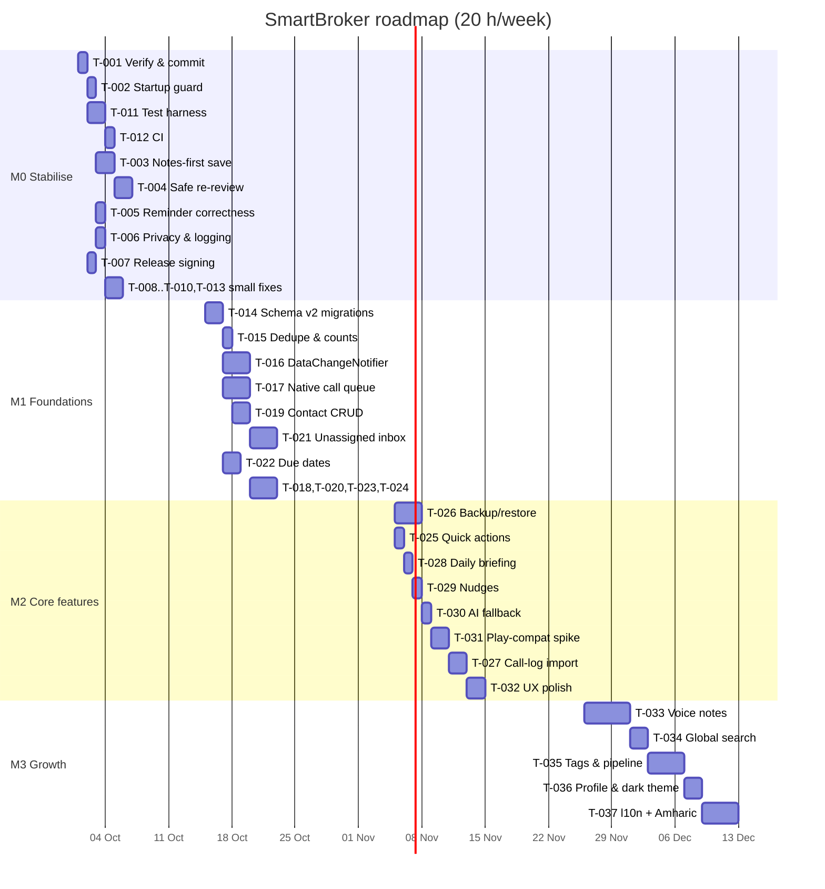
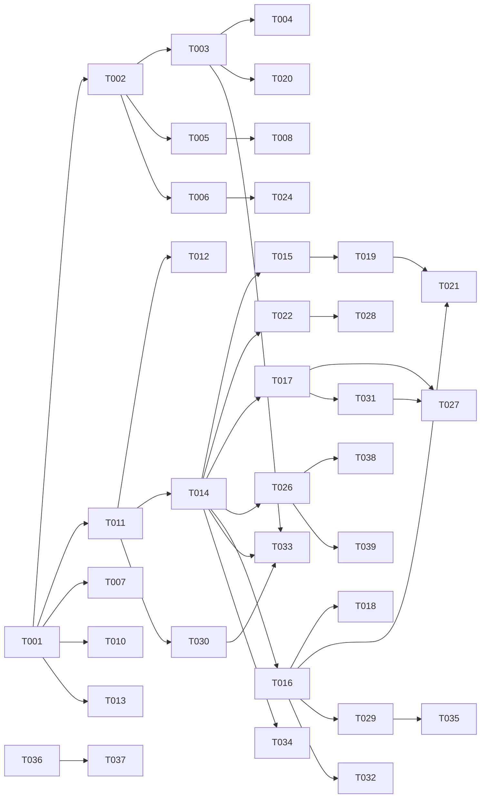

# 04 — Implementation plan

Assumptions used for sizing **[Assumed]**: one developer at ~20 productive hours/week, working with an AI coding assistant; a Windows machine with Flutter ≥3.38.4 at `C:\flutter`; one Samsung test phone (Android 13/14, per `OnBackInvokedCallback` warnings in the device log); no budget for paid services. Estimates are engineering hours including tests; wall-clock durations assume the 20 h/week capacity.

Conventions every task must follow (from the existing codebase): feature screens under `lib/features/<feature>/screens/`, shared widgets under `lib/core/widgets/`, one repository per table under `lib/core/repositories/` using `DatabaseHelper().database` and parameterised `db.query/insert/update/delete`, services as singletons with a `factory` constructor, models with `toMap/fromMap/copyWith`, `AppColors/AppSpacing/AppRadius` tokens, `lucide_icons` icons, `intl` for dates, tests under `test/` mirroring `lib/`.

New dependency versions are **[Inferred]**: each task says `flutter pub add <pkg>` — accept the version the resolver picks for Flutter 3.38 / Dart 3.11 and pin it in `pubspec.yaml`.

---

## 7.1 Roadmap

| Milestone | Goal | Tasks | Exit criteria | Duration |
|---|---|---|---|---|
| **M0 — Stabilise & secure** | Nothing loses data, the app always opens, the current working tree is built, tested and committed, CI exists | T-001 … T-013 | `flutter analyze` clean; `flutter test` green in CI; note saved before AI; re-review non-destructive; reminders validated; consent notice; release signing; seed only in debug; overlay verified on device once | 2 weeks (~40 h) |
| **M1 — Foundations** | Schema v2/v3 with migrations, unassigned calls, due dates, native call queue, contact CRUD, fresh data everywhere | T-014 … T-024 | Migration from v1 tested on a real v1 DB; unknown calls land in inbox; tasks have due dates; calls captured after app kill; contact create/edit/delete; no `.then(_loadData)` needed for freshness | 3 weeks (~60 h) |
| **M2 — Core features** | Make the daily loop faster and safer: backup, quick actions, briefing, fallback AI, nudges, call-log import, Play decision | T-025 … T-032 | Backup file round-trips; one-tap call/WhatsApp; 8:00 briefing; AI survives a 429; ADR on distribution | 3 weeks (~60 h) |
| **M3 — Growth** | Voice notes, search, pipeline/tags, personalisation, localisation | T-033 … T-037 | Voice memo → note; global search; tags & stages; dark mode; Amharic strings compile | 4 weeks (~80 h) |
| **M4 — Scale (later)** | Sync design, encryption | T-038, T-039 | ADRs accepted; spike results | when needed |

Dependency graph (cross-task edges only; acyclic):

---

## 7.2 Task breakdown

Priorities: P0 = blocks safe use · P1 = next · P2 = when convenient.

### Milestone M0 — Stabilise & secure

### T-001: Build, verify and commit the current working tree
- Milestone: M0 | Priority: P0 | Size: S | Estimate: 4h
- Addresses: F-009, I-012
- Depends on: none
- Context: 35 files (Dart, Kotlin, manifest) are modified and were never compiled. Everything else in this plan builds on a known-good commit.
- Files to modify: whatever `flutter analyze` flags; likely candidates are `lib/core/services/call_matching_service.dart`, `lib/features/calls/screens/call_overlay_screen.dart`, `lib/features/settings/screens/settings_screen.dart`, `android/app/src/main/kotlin/com/smartbroker/smart_broker/CallDetectionService.kt`.
- Files to create: `docs/system-review/device-checklist.md` — the manual device checklist used by TC-002/TC-003 and later tasks.
- Implementation steps:
  1. On the Windows machine: `flutter pub get`, `flutter analyze`, `flutter test`, `flutter build apk --debug`.
  2. Fix every analyzer error/warning in the touched files (no `// ignore` without justification).
  3. Install on the Samsung device; run Settings → Developer Tools → Simulate Call (incoming, known contact) and confirm the overlay appears, accepts typing, and "Save & Process" → reopening the app opens AI Review.
  4. Commit in three commits: (a) AI provider switch + tests, (b) overlay/call-detection rework (Dart + Kotlin + manifest), (c) README/cleanup.
- Data/schema changes: none
- API/contract changes: none
- Config/env changes: none
- Tests to add: TC-001, TC-002, TC-003 (manual; recorded in the device checklist)
- Acceptance criteria:
  - [ ] `flutter analyze` reports 0 issues
  - [ ] `flutter test` passes (25 existing tests)
  - [ ] Simulated call shows overlay with the contact name; typed note reaches AI Review after reopening the app
  - [ ] `git status` clean; 3 commits with clear messages
- Risks & mitigations: `flutter_overlay_window` API names may differ from the 0.5.0 docs → check `~/.pub-cache/hosted/pub.dev/flutter_overlay_window-0.5.0/lib/src/overlay_window.dart` and adjust.
- Rollout & rollback: commits only; revert individual commits if a subsystem misbehaves.

### T-002: Guard app startup against initialisation failures
- Milestone: M0 | Priority: P0 | Size: S | Estimate: 4h
- Addresses: F-002, I-001
- Depends on: T-001
- Context: `main()` awaits four fallible steps before `runApp`; one exception = permanent blank screen.
- Files to modify: `lib/main.dart:26-42` — wrap steps; `lib/core/services/notification_service.dart:26-30` — timezone fallback.
- Files to create: `lib/features/home/screens/startup_error_screen.dart` — shows the error, "Try again" (re-runs init) and "Reset local data" (deletes `smart_broker.db` via sqflite `deleteDatabase`, then re-runs).
- Implementation steps:
  1. Replace the sequential awaits with `final failure = await _initialise();` where `_initialise()` runs each step in its own `try/catch`, logs, and continues for non-fatal steps (`NotificationService.init`, `rescheduleAll`, `_restoreCallDetection`). Only DB open/seed failure is fatal (returns the error).
  2. In `NotificationService.init()`, wrap `tz.setLocalLocation(tz.getLocation(...))` in try/catch falling back to `tz.setLocalLocation(tz.UTC)`; expose `bool timezoneFallback` for Settings.
  3. Wrap `runApp` in `runZonedGuarded`; set `FlutterError.onError` and `PlatformDispatcher.instance.onError` to log (T-024 later routes to `AppLog`).
  4. If `failure != null`, `runApp(MaterialApp(home: StartupErrorScreen(error: failure, onRetry: main)))`.
- Data/schema changes: none
- API/contract changes: none
- Config/env changes: none
- Tests to add: TC-004, TC-005, TC-006, TC-007
- Acceptance criteria:
  - [ ] Forcing `tz.getLocation` to throw still results in `SmartBrokerApp` being built
  - [ ] Simulating a DB open failure shows `StartupErrorScreen`; "Reset local data" works
  - [ ] Normal launch path unchanged (widget test pumps `SmartBrokerApp` on an ffi DB)
- Risks & mitigations: "Reset local data" is destructive → double confirmation.
- Rollout & rollback: no flag; revert commit.

### T-003: Notes-first save — persist the note before AI review
- Milestone: M0 | Priority: P0 | Size: M | Estimate: 10h
- Addresses: F-003, I-002
- Depends on: T-002
- Context: a note only exists today if the LLM call succeeds. The note must be durable first; AI is enrichment.
- Files to modify:
  - `lib/features/notes/screens/add_note_screen.dart:83-103` — "AI Review" becomes "Save" (primary) + "Save & AI Review"; `Save` inserts the `Note` (`aiSummary: ''`) via the new `NoteRepository.saveNote`, clears the draft, pops. "Save & AI Review" inserts first, then pushes `AppRoutes.aiReview` with `noteId`.
  - `lib/features/notes/screens/ai_review_screen.dart` — `noteId` required (drop the `if (_noteId == null)` insert branch, ≈`:247-254`); error state gets "Keep note without AI" (pops); "Skip for now" (`:169-172`) pops with the note kept.
  - `lib/features/notes/screens/note_detail_screen.dart` — "AI summary not generated — Run AI" affordance when `aiSummary.isEmpty` (reuse the re-run action at `:179-190`).
  - `lib/core/services/notification_service.dart:69-79` and `lib/main.dart:75-82` — pending overlay notes are inserted via `saveNote` before navigating to AI Review.
  - `lib/features/contacts/screens/contact_detail_screen.dart` `_NotesList` — notes with empty summary show the `rawText` preview and an "Unprocessed" `InfoChip`.
- Files to create: none
- Implementation steps:
  1. Add `Future<String> saveNote({required String contactId, required String rawText, String? existingNoteId})` to `NoteRepository`: insert or update plus `UPDATE contacts SET lastInteraction = ?` in one `db.transaction`.
  2. Rewire `AddNoteScreen` actions; keep `OverlayDraftService.clearDraft` after a successful insert.
  3. In `AiReviewScreen`, read `args['noteId']` as required; on save only `update` `aiSummary`.
  4. Update `CallOverlayState.takePendingReview` consumers to insert the note first and pass `noteId`.
- Data/schema changes: none (`aiSummary TEXT NOT NULL` already accepts `''`)
- API/contract changes: `/ai-review` route args now require `noteId` (internal)
- Config/env changes: none
- Tests to add: TC-008, TC-009, TC-010, TC-011, TC-012
- Acceptance criteria:
  - [ ] With no API key, "Save" stores the note and it appears on the contact
  - [ ] With the AI mocked to throw, "Keep note without AI" leaves the note persisted with empty summary
  - [ ] Successful AI review updates the same note row (no duplicate)
  - [ ] Overlay note → reopen app → AI Review shows the pre-inserted note
- Risks & mitigations: many "Unprocessed" notes if the key is missing → Home banner "N notes waiting for AI" (T-020).
- Rollout & rollback: revert commit; no data migration.

### T-004: Make AI re-review non-destructive and transactional
- Milestone: M0 | Priority: P0 | Size: M | Estimate: 8h
- Addresses: F-001, I-002
- Depends on: T-003
- Context: `_saveToProfile` deletes every linked todo/reminder and re-inserts; completed tasks are lost and the sequence is not atomic.
- Files to modify: `lib/features/notes/screens/ai_review_screen.dart` (`_saveToProfile`, ≈`:221-330`), `lib/core/repositories/todo_repository.dart`, `lib/core/repositories/reminder_repository.dart`, `lib/core/repositories/note_repository.dart` (optional `DatabaseExecutor? executor` parameter on `insert/update/delete`).
- Files to create: `lib/core/services/note_save_service.dart` — `NoteSaveService.applyReview({noteId, summary, taskTitles, reminder?})`.
- Implementation steps:
  1. `applyReview` opens `db.transaction((txn) async { ... })` and passes `txn` to repository methods.
  2. Merge rules: load existing todos for the note; keep all completed ones; keep open ones whose title matches (case/whitespace-insensitive) a new title; delete unmatched open ones; insert new titles. Reminder: update existing if the switch is on; cancel + delete if off.
  3. Before the transaction, if any open todos will be deleted, show a confirm dialog listing them (extend the existing "Save to Profile?" dialog, ≈`:224-235`).
  4. Recount `pendingTasksCount` once inside the transaction (`TodoRepository.recountForContact(executor, contactId)`, extracted from `_updateContactTasksCount`).
  5. After commit: `NotificationService.cancelReminder/scheduleReminder` as today (≈`:303-309`), then `OverlayDraftService.clearDraft`.
- Data/schema changes: none
- API/contract changes: repositories gain an optional executor parameter (backward compatible)
- Config/env changes: none
- Tests to add: TC-013, TC-014, TC-015, TC-016, TC-017
- Acceptance criteria:
  - [ ] Re-reviewing a note with one completed and one open task, where the AI returns a different list, keeps the completed task
  - [ ] If an insert throws mid-way, the note's tasks are unchanged
  - [ ] `pendingTasksCount` equals the number of open todos after save
- Risks & mitigations: title matching may keep a task the user meant to replace → the confirm dialog lists exactly what is kept/deleted.
- Rollout & rollback: revert commit.

### T-005: Reminder correctness — validation, stable notification ids, no `cancelAll`
- Milestone: M0 | Priority: P0 | Size: S | Estimate: 4h
- Addresses: F-004, F-014, I-006
- Depends on: T-002
- Context: past-dated reminders are accepted and never fire; launch cancels live notifications; ids come from `String.hashCode`.
- Files to modify: `lib/features/calendar/screens/calendar_screen.dart:395-520`, `lib/features/calendar/screens/reminder_detail_screen.dart:114-129,170-196`, `lib/features/notes/screens/ai_review_screen.dart` (`_pickDateTime` ≈`:200-219`, reminder save ≈`:293-309`), `lib/core/services/notification_service.dart:117,132,184,188-195`.
- Files to create: `lib/core/utils/reminder_time.dart` — `DateTime nextFullHour([DateTime? now])`, `bool isSchedulable(DateTime)`, `int stableId(String)` (31-bit FNV-1a).
- Implementation steps:
  1. Default `_selectedTime` to `nextFullHour()` when the initial date is today, else 09:00.
  2. In all three save paths, if `!isSchedulable(dateTime)`, show "This time has already passed — Save anyway (no notification) / Change time".
  3. Replace `id.hashCode.abs()` with `stableId(id)` in `NotificationService`.
  4. `rescheduleAll()`: load all reminders, `cancel(stableId(r.id))` each (and, once, the legacy `hashCode.abs()` ids, guarded by pref `legacy_ids_cancelled`), then schedule the upcoming ones; delete the `cancelAll()` call.
  5. `scheduleReminder` returns `Future<bool>`; callers show "Reminder saved (no notification: time is in the past)" when false.
- Data/schema changes: none (T-014 persists `notificationId`)
- API/contract changes: `scheduleReminder` returns `Future<bool>`
- Config/env changes: pref `legacy_ids_cancelled` (bool, default false)
- Tests to add: TC-018, TC-019, TC-020, TC-021, TC-022, TC-023
- Acceptance criteria:
  - [ ] Opening "Add Reminder" at 14:20 defaults to 15:00 today
  - [ ] Saving a reminder for 5 minutes ago prompts; "change time" returns to the sheet
  - [ ] `stableId('abc')` is identical across runs and in `[0, 2³¹)`
  - [ ] A displayed post-call notification survives `rescheduleAll()` (device check)
- Risks & mitigations: id change orphans alarms from old builds → one-shot legacy cancellation in step 4.
- Rollout & rollback: revert; legacy cancellation is idempotent.

### T-006: AI processing consent notice and release-safe logging of sensitive data
- Milestone: M0 | Priority: P0 | Size: S | Estimate: 4h
- Addresses: F-005, I-004
- Depends on: T-002
- Context: client notes go to a third party with no notice; note/number contents are logged in release.
- Files to modify: `lib/core/services/ai_service.dart:271,278`, `lib/core/services/call_matching_service.dart:257,269,279,296`, `lib/features/notes/screens/ai_review_screen.dart:84-92`, `lib/features/settings/screens/settings_screen.dart` (AI section, `_selectProvider`), `lib/core/services/settings_service.dart`.
- Files to create: `lib/core/widgets/ai_consent_dialog.dart`.
- Implementation steps:
  1. `SettingsService.getAiConsentAccepted/setAiConsentAccepted`; reset on provider change.
  2. `AiConsentDialog`: what is sent (note text, contact first name, previous summaries, open task titles), to which provider (`AiProvider.name`), link to its data policy; "Not now" / "I understand".
  3. Show once before the first `analyzeNote` and after a provider change.
  4. Replace the listed `debugPrint`s with masked forms (`_mask('+251911234567') == '+2519****567'`; log `content.length`, never `content`) behind `if (kDebugMode)`.
  5. "Data & privacy" tile in Settings reopens the notice.
- Data/schema changes: none
- API/contract changes: none
- Config/env changes: pref `ai_consent_accepted` (bool, default false)
- Tests to add: TC-024, TC-025, TC-026, TC-027
- Acceptance criteria:
  - [ ] First AI Review shows the dialog; declining makes zero HTTP requests
  - [ ] Accepting persists; no repeat
  - [ ] Release logcat during a simulated call contains no note text or full number
- Risks & mitigations: none significant.
- Rollout & rollback: revert; pref harmless.

### T-007: Release signing, app identity and backup rules
- Milestone: M0 | Priority: P0 | Size: S | Estimate: 3h
- Addresses: F-006, I-003
- Depends on: T-001
- Context: release builds use the debug keystore; label is `smart_broker`; backups implicit.
- Files to modify: `android/app/build.gradle.kts:35-39`, `android/app/src/main/AndroidManifest.xml:17-25`, `pubspec.yaml` (`version: 1.0.0+2`), `README.md`.
- Files to create: `android/key.properties.example`, `android/app/proguard-rules.pro`, `android/app/src/main/res/xml/backup_rules.xml`, `android/app/src/main/res/xml/data_extraction_rules.xml`, `docs/RELEASE.md`.
- Implementation steps:
  1. Generate a keystore once (`keytool -genkey -v -keystore smartbroker-release.jks -alias smartbroker -keyalg RSA -keysize 2048 -validity 10000`) stored outside the repo; document in `docs/RELEASE.md`.
  2. `build.gradle.kts`: read `key.properties` into `signingConfigs.create("release")`; `release.signingConfig = signingConfigs.getByName("release")`; `isMinifyEnabled = true`, `isShrinkResources = true`; keep rules for `flutter.overlay.window.**` and `com.smartbroker.**`.
  3. Manifest: `android:label="SmartBroker"`, `android:allowBackup="true"`, `android:fullBackupContent="@xml/backup_rules"`, `android:dataExtractionRules="@xml/data_extraction_rules"` (include `databases/smart_broker.db` and shared prefs; exclude the `FlutterSecureStorage` prefs file), `android:enableOnBackInvokedCallback="true"`.
  4. Add the `flutter build appbundle --release` recipe to `docs/RELEASE.md`.
- Data/schema changes: none
- API/contract changes: none
- Config/env changes: `android/key.properties` (gitignored, `android/.gitignore:12`)
- Tests to add: TC-028, TC-029, TC-030
- Acceptance criteria:
  - [ ] `flutter build apk --release` succeeds; `apksigner verify --print-certs` shows the release certificate
  - [ ] Launcher shows "SmartBroker"
  - [ ] Backup rules include the DB and exclude secure-storage prefs
- Risks & mitigations: losing the keystore = cannot update the app → two offline copies. Minify may strip reflection-used classes → verify overlay + notifications on a release build.
- Rollout & rollback: the first release-signed install requires uninstalling debug builds (data loss) → do it after T-026 (backup) exists, or export the DB manually first.

### T-008: Seed demo data only in debug builds
- Milestone: M0 | Priority: P1 | Size: S | Estimate: 2h
- Addresses: F-010, I-007
- Depends on: T-005
- Context: every fresh install gets 8 fake contacts (and scheduled fake reminders); mock data contains a real-looking identity.
- Files to modify: `lib/core/database/seed_data.dart:14-19`, `lib/main.dart:28`, `lib/features/settings/screens/settings_screen.dart` (Developer Tools), `lib/mock/mock_contacts.dart:4-13`.
- Files to create: none
- Implementation steps:
  1. `seedIfNeeded()` early-returns unless `kDebugMode` (inject a `bool` for tests); add `loadDemoData()` used by a debug-only "Load demo data" tile.
  2. Replace identities with fictional names, `example.com` emails, `+2519000000xx` numbers.
  3. Verify `EmptyStateWidget` paths on Home/Contacts/Calendar with an empty DB.
- Data/schema changes: none
- API/contract changes: none
- Config/env changes: none
- Tests to add: TC-031, TC-032, TC-033
- Acceptance criteria:
  - [ ] Fresh release install shows zero contacts
  - [ ] Debug build still seeds; "Load demo data" works on an empty DB
- Risks & mitigations: none.
- Rollout & rollback: revert.

### T-009: Bundle the Inter font
- Milestone: M0 | Priority: P2 | Size: S | Estimate: 1h
- Addresses: F-015, I-009
- Depends on: none
- Context: `google_fonts` downloads Inter at runtime, causing an offline fallback and an external request on cold start.
- Files to modify: `pubspec.yaml` (`flutter: fonts:`), `lib/core/theme/app_theme.dart:48`, `lib/main.dart` (`GoogleFonts.config.allowRuntimeFetching = false;` before init).
- Files to create: `assets/fonts/Inter-Regular.ttf`, `Inter-Medium.ttf`, `Inter-SemiBold.ttf`, `Inter-Bold.ttf`, `assets/fonts/OFL.txt`.
- Implementation steps: declare family `Inter` in `pubspec.yaml`; keep `GoogleFonts.interTextTheme()` (uses bundled assets when present) or switch to `ThemeData(fontFamily: 'Inter')`; disable runtime fetching.
- Data/schema changes: none
- API/contract changes: none
- Config/env changes: none
- Tests to add: TC-034, TC-035
- Acceptance criteria:
  - [ ] Airplane-mode cold start renders Inter
  - [ ] No request to `fonts.gstatic.com` in a network capture
- Risks & mitigations: APK grows ~600 KB — acceptable.
- Rollout & rollback: revert.

### T-010: `mounted` guards, controller disposal and small crash fixes
- Milestone: M0 | Priority: P1 | Size: S | Estimate: 3h
- Addresses: F-022, F-027, F-033 (b, c, d), I-014
- Depends on: T-001
- Context: several `setState` calls follow awaits without `mounted`; controllers created in sheets are never disposed; `capitalize()` throws on empty strings; Gradle heap is set to 8 GB.
- Files to modify: `lib/features/notes/screens/notes_list_screen.dart:60-71`, `lib/features/notes/screens/note_detail_screen.dart:115-127`, `lib/features/calendar/screens/reminder_detail_screen.dart:34-62,106-129,170-196`, `lib/features/contacts/screens/contact_detail_screen.dart:598-650,755-758`, `lib/core/widgets/todo_tile.dart:148-200`, `lib/features/calendar/screens/calendar_screen.dart:395-410`, `lib/features/todos/screens/tasks_screen.dart:25-26`, `android/gradle.properties:1`.
- Files to create: none
- Implementation steps:
  1. Insert `if (!mounted) return;` after each `await` that precedes `setState` in the listed methods.
  2. `reminder_detail_screen.dart`: create both controllers in `initState`, fill them in `_enterEditMode`, dispose once in `dispose()`; remove the conditional dispose.
  3. Sheet/dialog controllers: `showModalBottomSheet(...).whenComplete(controller.dispose)`; add `dispose()` to `_AddReminderSheetState`.
  4. `capitalize()` returns `this` when empty.
  5. Replace filter/sort strings with `enum TaskFilter { all, pending, completed, overdue }` and `enum TaskSort { createdAt, contact }`.
  6. `org.gradle.jvmargs=-Xmx4G -XX:MaxMetaspaceSize=1G -XX:ReservedCodeCacheSize=512m -XX:+HeapDumpOnOutOfMemoryError`.
- Data/schema changes: none
- API/contract changes: `TodoRepository.getAll` accepts the enums (internal)
- Config/env changes: Gradle heap 8G → 4G
- Tests to add: TC-036, TC-037, TC-038, TC-039, TC-040
- Acceptance criteria:
  - [ ] Widget test navigates away during a pending `_performSearch` without exceptions
  - [ ] `''.capitalize()` returns `''`
  - [ ] Gradle build succeeds with the 4 GB setting
- Risks & mitigations: none.
- Rollout & rollback: revert.

### T-011: Test harness — repositories on in-memory SQLite, AI service with `MockClient`
- Milestone: M0 | Priority: P0 | Size: M | Estimate: 10h
- Addresses: F-018, I-012
- Depends on: T-001
- Context: nothing touching the DB or network is tested; establish the patterns every later task reuses.
- Files to modify: `pubspec.yaml` (`flutter pub add --dev sqflite_common_ffi`), `lib/core/database/database_helper.dart` (add `static Future<void> resetForTesting()` → `close()` + `deleteDatabase(path)`), `lib/core/services/ai_service.dart` (constructor gains `http.Client? client`, default `http.Client()`; `_post` uses it), `lib/core/services/contact_merge_service.dart` (optional `PhoneContactService` constructor param).
- Files to create: `test/helpers/test_db.dart`, `test/helpers/fixtures.dart`, `test/helpers/fakes.dart`, `test/fixtures/ai/*.json`, `test/core/repositories/{contact,todo,reminder,note,call}_repository_test.dart`, `test/core/services/ai_service_test.dart`, `test/core/services/contact_merge_service_test.dart`.
- Implementation steps:
  1. `setUpTestDatabase()`: `sqfliteFfiInit(); databaseFactory = databaseFactoryFfi; await DatabaseHelper.resetForTesting();` — `openDatabase` delegates to the global factory, so `DatabaseHelper` needs no other change.
  2. Repository tests for existing behaviour: cascades, `pendingTasksCount`, `getUpcoming/getOpen/getOverdue`, `toggleCompleted/setCompleted`, `getAll(filter:)`, note search, call ordering.
  3. `AiService` tests with `MockClient`: fenced JSON, 400→retry without schema, 401/429/timeout mapping, `reasoning_effort` only for Groq.
  4. `ContactMergeService` dedupe and last-9-digit matching with a fake phone service.
- Data/schema changes: none
- API/contract changes: constructor injection points (backward compatible defaults)
- Config/env changes: dev dependency `sqflite_common_ffi`
- Tests to add: TC-041, TC-042, TC-043, TC-044, TC-045, TC-046, TC-047
- Acceptance criteria:
  - [ ] `flutter test` runs ≥ 60 tests green in < 30 s
  - [ ] No test touches the real device DB path
- Risks & mitigations: `sqflite_common_ffi` needs a native sqlite on CI runners — bundled for Linux/Windows.
- Rollout & rollback: none needed.

### T-012: GitHub Actions CI
- Milestone: M0 | Priority: P0 | Size: S | Estimate: 3h
- Addresses: F-018, I-012
- Depends on: T-011
- Context: tests are only run by hand; nothing prevents a broken `main`.
- Files to modify: `README.md` (badge + "CI" section).
- Files to create: `.github/workflows/ci.yml`, `.github/workflows/deps-weekly.yml`, `tool/coverage_gate.sh`, `tool/no_dead_handlers.sh`.
- Implementation steps:
  1. `ci.yml` (see `05-test-plan.md §7.3.7`): checkout → Java 17 → `subosito/flutter-action@v2` (stable 3.38.x, cache) → `pub get` → `dart format --set-exit-if-changed` → `flutter analyze --fatal-infos` → `flutter test --coverage` → `tool/coverage_gate.sh 40` → `tool/no_dead_handlers.sh` → `flutter build apk --debug` → upload artifact.
  2. `deps-weekly.yml`: scheduled `flutter pub outdated` that opens/updates an issue.
  3. Protect `main` (require the `flutter` job).
- Data/schema changes: none
- API/contract changes: none
- Config/env changes: none
- Tests to add: TC-048, TC-049, TC-050
- Acceptance criteria:
  - [ ] A PR with a failing test is red
  - [ ] `main` is green in < 12 min
- Risks & mitigations: Gradle download time → cache `~/.gradle`.
- Rollout & rollback: none needed.

### T-013: Gate the call overlay and post-call prompt by contact knowledge
- Milestone: M0 | Priority: P1 | Size: S | Estimate: 3h
- Addresses: F-021 (interim), I-017
- Depends on: T-001
- Context: the overlay and the post-call prompt appear for every caller, including spam.
- Files to modify: `lib/core/services/settings_service.dart` (enum pref `overlay_mode`: `knownOnly` (default) | `all` | `off`; migrate from `show_call_overlay`), `lib/core/services/call_matching_service.dart:113-137,158-190,299-303`, `lib/features/settings/screens/settings_screen.dart:395-530` (segmented control).
- Files to create: `lib/core/services/overlay_gateway.dart` — thin wrapper over `FlutterOverlayWindow` static calls so tests can inject a fake.
- Implementation steps:
  1. In `_handleStateChange` for `ringing`/`offhook`, resolve `_contextFor(number)` first; show the overlay only if mode is `all` or a contact matched.
  2. Post-call prompt only when a contact matched (T-021 adds the "assign" prompt for unknown callers).
- Data/schema changes: none
- API/contract changes: none
- Config/env changes: pref `overlay_mode` (default `knownOnly`); `show_call_overlay` read once for migration
- Tests to add: TC-051, TC-052, TC-053, TC-054
- Acceptance criteria:
  - [ ] Simulated call from an unknown number shows no overlay in `knownOnly`
  - [ ] Known number shows the overlay with the name
- Risks & mitigations: none.
- Rollout & rollback: default `knownOnly`; revert restores old behaviour.

### Milestone M1 — Foundations

### T-014: Schema v2 — versioned migrations, indexes, phone key, notification id, due date, unassigned calls
- Milestone: M1 | Priority: P0 | Size: M | Estimate: 10h
- Addresses: F-011, F-012, F-014, F-020, I-008 (enables N-001, N-002)
- Depends on: T-011
- Context: first-ever migration; must be safe on real v1 databases and set the pattern for all later schema work.
- Files to modify: `lib/core/database/database_helper.dart:22-26,106-108` (`version: 2`; `_onUpgrade` runs `migrations.where((m) => m.version > old && m.version <= new)` in order), `lib/models/contact.dart` (`phoneKey`), `lib/models/todo_item.dart` (`dueAt`), `lib/models/reminder.dart` (`notificationId`), `lib/core/repositories/contact_repository.dart` (`insert/update` set `phoneKey = PhoneContact.matchKey(phoneNumber)`; add `findByPhone`), `lib/core/repositories/reminder_repository.dart`, `lib/core/repositories/todo_repository.dart`, `lib/core/repositories/call_repository.dart` (`insert` swallows unique-index conflicts and returns the existing id).
- Files to create: `lib/core/database/migrations.dart` (`abstract class Migration { int get version; Future<void> up(DatabaseExecutor db); }`, `MigrationV2`), `lib/models/unassigned_call.dart`, `lib/core/repositories/unassigned_call_repository.dart`, `test/fixtures/db/v1_ddl.sql` (verbatim copy of today's `_onCreate` DDL), `test/core/database/migration_v2_test.dart`.
- Implementation steps (`MigrationV2.up`):
  1. `ALTER TABLE contacts ADD COLUMN phoneKey TEXT NOT NULL DEFAULT ''`; backfill per row from Dart with `PhoneContact.matchKey`; `CREATE INDEX idx_contacts_phoneKey ON contacts(phoneKey)` (non-unique until T-015 merges duplicates).
  2. `ALTER TABLE todos ADD COLUMN dueAt INTEGER`; `ALTER TABLE reminders ADD COLUMN notificationId INTEGER`; backfill `notificationId = stableId(id)`.
  3. `CREATE TABLE unassigned_calls (id TEXT PRIMARY KEY, phoneNumber TEXT NOT NULL, phoneKey TEXT NOT NULL, type INTEGER NOT NULL, duration INTEGER NOT NULL, timestamp INTEGER NOT NULL, status TEXT NOT NULL DEFAULT 'new', note TEXT NOT NULL DEFAULT '', createdAt INTEGER NOT NULL)`; `CREATE INDEX idx_unassigned_status ON unassigned_calls(status, timestamp)`.
  4. De-duplicate `calls` (`DELETE FROM calls WHERE rowid NOT IN (SELECT MIN(rowid) FROM calls GROUP BY contactId, timestamp)`) then `CREATE UNIQUE INDEX idx_calls_dedupe ON calls(contactId, timestamp)`; other indexes: `notes(contactId, createdAt)`, `todos(contactId, isCompleted)`, `todos(noteId)`, `todos(dueAt)`, `reminders(contactId, dateTime)`, `reminders(noteId)`, `reminders(completed, dateTime)`, `calls(contactId, timestamp)`.
  5. `_onCreate` builds the v2 schema directly; the v1 DDL lives only in the test fixture.
- Data/schema changes: as above; forward-only. Reversal = restore a backup (T-026) or reinstall the previous APK with a prior backup; `unassigned_calls` can be dropped safely.
- API/contract changes: models gain optional fields with defaults (backward compatible)
- Config/env changes: none
- Tests to add: TC-055, TC-056, TC-057, TC-058, TC-059, TC-060
- Acceptance criteria:
  - [ ] Migration test passes from a v1 fixture with duplicate-number contacts and duplicate calls
  - [ ] Fresh install creates v2 directly; `PRAGMA index_list` shows all indexes
  - [ ] Existing repository tests remain green
- Risks & mitigations: first migration on real data → ship with T-026 available; manual DB export before upgrading the developer's phone.
- Rollout & rollback: bump `version`; rollback = previous APK + restore backup.

### T-015: Duplicate-contact prevention and computed task counts
- Milestone: M1 | Priority: P1 | Size: S | Estimate: 5h
- Addresses: F-012, F-013, I-008
- Depends on: T-014
- Context: same number can exist twice; the stored `pendingTasksCount` drifts when full rows are rewritten.
- Files to modify: `lib/core/repositories/contact_repository.dart` (`getAll/getById/search` select `(SELECT COUNT(*) FROM todos t WHERE t.contactId = c.id AND t.isCompleted = 0) AS pendingTasksCount`; `update` writes only editable columns; `insert` returns the existing id when `findByPhone` hits), `lib/core/repositories/todo_repository.dart` (delete `_updateContactTasksCount` and callers), `lib/features/contacts/screens/phone_contact_detail_screen.dart:36-61` (open the existing contact when found), `lib/core/services/call_matching_service.dart:243-249` (use `findByPhone`), `lib/core/database/migrations.dart` (`MigrationV3`), `lib/core/database/database_helper.dart` (`version: 3`).
- Files to create: `test/core/database/migration_v3_test.dart`.
- Implementation steps:
  1. `MigrationV3.up`: for each `phoneKey` with > 1 contact, keep the oldest (`MIN(lastInteraction)`… use `rowid`), `UPDATE notes/todos/reminders/calls SET contactId = keep WHERE contactId IN (dups)`, delete the duplicates, then `CREATE UNIQUE INDEX idx_contacts_phoneKey_unique ON contacts(phoneKey) WHERE phoneKey <> ''`.
  2. Drop the stored `pendingTasksCount` from `Contact.toMap()` writes (keep the column for compatibility; ignore on read in favour of the subquery alias).
  3. `ContactRepository.insert`: `final existing = await findByPhone(contact.phoneNumber); if (existing != null) return existing.id;`.
- Data/schema changes: v3 merge of duplicates + partial unique index; forward-only (backup restore to reverse)
- API/contract changes: `ContactRepository.insert` may return an existing id (documented)
- Config/env changes: none
- Tests to add: TC-061, TC-062, TC-063, TC-064, TC-065
- Acceptance criteria:
  - [ ] Inserting a contact whose number matches an existing one returns the existing id
  - [ ] `pendingTasksCount` is always the live count
  - [ ] V3 migration merges duplicates and their children
- Risks & mitigations: merge keeps the oldest row — documented in the migration; backup first.
- Rollout & rollback: as T-014.

### T-016: `DataChangeNotifier` — fresh data without reload-on-pop
- Milestone: M1 | Priority: P1 | Size: L | Estimate: 14h
- Addresses: F-017, I-011
- Depends on: T-014
- Context: introduce the smallest reactive layer possible using Flutter's `ChangeNotifier` — no new dependency, no rewrite of screens' local state.
- Files to modify: every repository write method calls `DataChangeNotifier().notify(DataScope.x)` after commit; screens `home_screen.dart`, `contacts_screen.dart`, `contact_detail_screen.dart`, `calendar_screen.dart`, `tasks_screen.dart`, `notes_list_screen.dart`, `note_detail_screen.dart`, `reminder_detail_screen.dart` subscribe in `initState` (debounced 100 ms reload of the scopes they display) and unsubscribe in `dispose`; remove `.then((_) => _loadData())` chains and `popAndPushNamed` reload workarounds.
- Files to create: `lib/core/services/data_change_notifier.dart` (`enum DataScope { contacts, notes, todos, reminders, calls, unassignedCalls }`; singleton `ChangeNotifier` with `notify(Set<DataScope>)`, `Set<DataScope> lastChanged`), `test/core/services/data_change_notifier_test.dart`.
- Implementation steps:
  1. Add the notifier and wire repositories (one commit).
  2. Migrate screens one per commit, keeping behaviour identical; keep `RefreshIndicator` pull-to-refresh.
  3. Delete the `.then(_loadData)` chains; add the CI grep (TC-069).
- Data/schema changes: none
- API/contract changes: none
- Config/env changes: none
- Tests to add: TC-066, TC-067, TC-068, TC-069
- Acceptance criteria:
  - [ ] Completing a task on the Tasks tab updates Home stats without navigation
  - [ ] Adding a phonebook contact updates the Contacts list immediately
  - [ ] No remaining `.then((_) => _loadData())` in `lib/features`
- Risks & mitigations: reload storms → debounce + scope filtering; regressions → one screen per commit.
- Rollout & rollback: incremental; any screen can be reverted alone.

### T-017: Native call-event queue, robust call-log read and boot restart
- Milestone: M1 | Priority: P0 | Size: M | Estimate: 12h
- Addresses: F-007, F-024, I-005
- Depends on: T-014
- Context: events are dropped when Dart isn't attached; the call-log read is a fixed-delay guess; nothing restarts the service after reboot.
- Files to modify: `android/app/src/main/kotlin/com/smartbroker/smart_broker/CallDetectionService.kt:88-94,150-224,241-253`, `CallDetectionPlugin.kt:53-118`, `android/app/src/main/AndroidManifest.xml` (boot receiver), `lib/core/services/call_detection_service.dart` (`drainQueuedEvents()`), `lib/core/services/call_matching_service.dart:47-55` (`startListening` drains first), `lib/features/settings/screens/settings_screen.dart` (battery-optimisation guidance tile).
- Files to create: `android/.../CallEventQueue.kt` (JSON array in `SharedPreferences("smart_broker_call_queue")`; `enqueue/drain/size`), `android/.../BootReceiver.kt`, `android/app/src/test/kotlin/.../CallEventQueueTest.kt`.
- Implementation steps:
  1. `CallDetectionService.post()`: if `eventSink == null` and event is `call_logged`, `CallEventQueue.enqueue(event)`; state events are not queued.
  2. `fetchLastCallFromLog`: selection `DATE > ?` with `lastProcessedCallDate` persisted in prefs; if no newer row, retry once after 3 s; emit newer rows oldest-first; persist the newest date.
  3. Plugin method `drainQueuedEvents` → list of maps, clears the queue; Dart feeds each to `_handleRawEvent` before subscribing.
  4. `BootReceiver` (`RECEIVE_BOOT_COMPLETED` already declared): reads `flutter.call_detection_enabled` from `FlutterSharedPreferences` and starts the service.
  5. Foreground notification text: "Call detection active" vs "Calls will be logged when you open SmartBroker" depending on sink presence.
- Data/schema changes: none (relies on `idx_calls_dedupe`)
- API/contract changes: MethodChannel `smart_broker/call_detection` gains `drainQueuedEvents`
- Config/env changes: none
- Tests to add: TC-070, TC-071, TC-072, TC-073, TC-074, TC-075, TC-076
- Acceptance criteria:
  - [ ] Force-stop the app, receive a call, open the app → the call is on the contact
  - [ ] Reboot with detection enabled → foreground notification present
  - [ ] The same call-log row is never inserted twice
- Risks & mitigations: Samsung "sleeping apps" may still kill the service → in-app instructions to exempt from battery optimisation; Android 14 boot-start rules **[Inferred]** → verify TC-075.
- Rollout & rollback: revert Kotlin + Dart together.

### T-018: Phonebook cache and explicit permission onboarding
- Milestone: M1 | Priority: P2 | Size: M | Estimate: 5h
- Addresses: F-016, I-010
- Depends on: T-016
- Context: the entire phonebook is re-read and permission re-requested every time the Contacts tab loads.
- Files to modify: `lib/core/services/phone_contact_service.dart` (in-memory cache + `DateTime _cachedAt`, `getContacts({bool force = false})` with 5-min TTL, `bool get hasPermission`), `lib/core/services/contact_merge_service.dart:19-20` (no permission request inside data calls), `lib/features/contacts/screens/contacts_screen.dart:55-76,291` (`force: true` on pull-to-refresh; "Allow contacts access" banner when denied), `lib/features/settings/screens/settings_screen.dart` (Permissions section).
- Files to create: `lib/core/widgets/permission_banner.dart`.
- Implementation steps:
  1. Cache the list; invalidate on TTL, `force`, or app resume after > 5 min.
  2. Request contacts permission from the banner/Settings only.
- Data/schema changes: none
- API/contract changes: `getContacts` gains `force`
- Config/env changes: none
- Tests to add: TC-077, TC-078, TC-079, TC-080
- Acceptance criteria:
  - [ ] Returning to the Contacts tab within 5 min makes no `FlutterContacts.getAll` call
  - [ ] Pull-to-refresh does
- Risks & mitigations: stale phonebook for up to 5 min — acceptable; refresh available.
- Rollout & rollback: revert.

### T-019: Contact create / edit / delete
- Milestone: M1 | Priority: P1 | Size: M | Estimate: 8h
- Addresses: F-019, I-013
- Depends on: T-015
- Context: contacts can only enter the CRM via a call or the phonebook; no edit/delete exists.
- Files to modify: `lib/core/constants/app_routes.dart` (`contactForm = '/contact-form'`), `lib/main.dart` (route), `lib/features/contacts/screens/contacts_screen.dart:155` (→ form), `lib/features/contacts/screens/contact_detail_screen.dart:140` (⋯ → bottom sheet: Edit / Delete).
- Files to create: `lib/features/contacts/screens/contact_form_screen.dart` (`Form` with validators for name*/phone*, optional email/company/role; phone normalised via `PhoneContact.normalizePhoneNumber`; duplicate → "Open existing"), `test/features/contacts/contact_form_screen_test.dart`.
- Implementation steps:
  1. Form screen accepting `Contact?` (edit) or `String? prefillPhone` (from the inbox, T-021).
  2. Delete: confirm dialog listing child counts (query the four repositories), cancel reminder notifications via `NotificationService.cancelReminder` for each reminder, then `ContactRepository.delete` (cascade).
- Data/schema changes: none
- API/contract changes: new route `/contact-form`
- Config/env changes: none
- Tests to add: TC-081, TC-082, TC-083, TC-084, TC-085, TC-086
- Acceptance criteria:
  - [ ] A contact can be created by hand and appears in the list
  - [ ] Editing the phone keeps notes/tasks
  - [ ] Deleting cancels its reminder notifications and removes it everywhere
- Risks & mitigations: accidental deletes → explicit counts + confirm.
- Rollout & rollback: revert.

### T-020: Notes-list entry point and settings clean-up
- Milestone: M1 | Priority: P2 | Size: S | Estimate: 3h
- Addresses: F-019, I-013
- Depends on: T-003
- Context: `NotesListScreen` is unreachable; four Settings tiles do nothing; unprocessed notes (T-003) need a home.
- Files to modify: `lib/features/home/screens/home_screen.dart` (`SectionHeader('Recent notes', actionLabel: 'See all')` → `AppRoutes.notesList`; banner "N notes waiting for AI"), `lib/features/settings/screens/settings_screen.dart:298-303,398-402,536-556` (remove Theme, Clear AI Cache, Debug Menu; implement Reset data = confirm → delete DB + `rescheduleAll()` + restart at Home), `lib/core/constants/app_routes.dart:7,15` (delete unused constants).
- Files to create: `tool/no_dead_handlers.sh` (if not already from T-012).
- Implementation steps: as listed; "Reset data" reuses the deletion routine from T-002's error screen.
- Data/schema changes: none
- API/contract changes: none
- Config/env changes: none
- Tests to add: TC-087, TC-088, TC-089
- Acceptance criteria:
  - [ ] Notes list reachable from Home
  - [ ] No `onTap: () {}` / `onPressed: () {}` left in `lib/`
- Risks & mitigations: Reset data is destructive → confirm + auto-export once T-026 exists.
- Rollout & rollback: revert.

### T-021: Unassigned calls inbox
- Milestone: M1 | Priority: P0 | Size: M | Estimate: 12h
- Addresses: F-021, N-001
- Depends on: T-014, T-016, T-019
- Context: unknown callers must stop becoming contacts; the product owner asked for an inbox with assign/create/dismiss.
- Files to modify: `lib/core/services/call_matching_service.dart:270-279` (unknown → `UnassignedCallRepository.insert`; prompt "Unknown caller — assign?" with payload `/unassigned?id=`), `lib/core/services/notification_service.dart:69-95` (route `/unassigned`), `lib/features/home/screens/home_screen.dart` (stat pill "N unassigned"), `lib/features/contacts/screens/contacts_screen.dart` (app-bar badge), `lib/core/constants/app_routes.dart`, `lib/main.dart`.
- Files to create: `lib/features/calls/screens/unassigned_calls_screen.dart`, `lib/core/widgets/unassigned_call_tile.dart`, `test/features/calls/unassigned_calls_screen_test.dart`.
- Implementation steps:
  1. Screen lists rows with `status = 'new'` grouped by `phoneKey` (count, last time, types).
  2. Actions: **Create contact** (→ `ContactFormScreen(prefillPhone)`, then assign), **Assign to…** (contact picker reusing the dropdown pattern from `tasks_screen.dart:451-466`), **Dismiss** (`status = 'dismissed'`).
  3. Assign = one transaction: insert `CallEntry` per call (ignore unique conflicts), delete the unassigned rows, `ContactRepository.touch`, `CallOverlayState.attachContactToPendingReview`, move `overlay_draft_unknown_caller` to the contact's draft key.
- Data/schema changes: uses `unassigned_calls` (T-014)
- API/contract changes: new route `/unassigned-calls`; notification payload `/unassigned?id=`
- Config/env changes: none
- Tests to add: TC-090, TC-091, TC-092, TC-093, TC-094, TC-095, TC-096
- Acceptance criteria:
  - [ ] An unknown-number call creates no contact and appears in the inbox
  - [ ] Assign moves it to the contact's call history
  - [ ] Create-contact from the inbox prefills the number
  - [ ] Dismissed rows are hidden; repeat calls group with them
- Risks & mitigations: inbox noise from spam → group by number; "Dismiss all from this number".
- Rollout & rollback: revert; table stays (harmless).

### T-022: Task due dates and real overdue semantics
- Milestone: M1 | Priority: P1 | Size: M | Estimate: 8h
- Addresses: F-020, N-002
- Depends on: T-014
- Context: "overdue" currently means "created > 7 days ago"; brokers work to dates the AI already extracts.
- Files to modify: `lib/models/todo_item.dart` (`dueAt`), `lib/models/ai_result.dart` (`List<AiActionItem>` with `title`, `dueDate?`), `lib/core/services/ai_response_parser.dart` (accept string or object items), `lib/core/services/ai_service.dart` (`_noteSchema.actionItems` → object schema `{title, dueDate}` with `required` both and `dueDate` allowed `''`), `lib/core/repositories/todo_repository.dart:14-45` (overdue = `dueAt IS NOT NULL AND dueAt < ? AND isCompleted = 0`; `getDueToday()`), `lib/core/widgets/todo_tile.dart` (due chip), `lib/features/todos/screens/tasks_screen.dart` and `lib/features/contacts/screens/contact_detail_screen.dart:598-650` add sheets (optional date), `lib/features/notes/screens/ai_review_screen.dart` (per-task date chip), `lib/features/home/screens/home_screen.dart:176-179`.
- Files to create: `lib/models/ai_action_item.dart`.
- Implementation steps:
  1. Model + parser (backward compatible) + schema.
  2. Repository filters and `getDueToday`.
  3. UI chips and pickers; default time 09:00 for date-only input.
- Data/schema changes: `todos.dueAt` (added in T-014; nullable)
- API/contract changes: AI JSON schema changes (system prompt updated; old string form still parsed)
- Config/env changes: none
- Tests to add: TC-097, TC-098, TC-099, TC-100, TC-101, TC-102
- Acceptance criteria:
  - [ ] `{"title":"Send offer","dueDate":"2026-10-02"}` becomes a task due Oct 2 09:00
  - [ ] Legacy string items still parse
  - [ ] Overdue filter shows only past-due open tasks
- Risks & mitigations: model may ignore the object schema without strict mode → parser tolerance.
- Rollout & rollback: revert; column stays nullable.

### T-023: Remove unsupported platform scaffolding
- Milestone: M1 | Priority: P2 | Size: S | Estimate: 1h
- Addresses: F-030, I-015
- Depends on: none
- Context: `web/`, `linux/`, `macos/`, `windows/` invite wrong-target runs that crash on `dart:io`/sqflite.
- Files to modify: `README.md` ("Running locally" → Android only), `.gitignore` (no change needed).
- Files to create: none (deletions: `web/`, `linux/`, `macos/`, `windows/`; keep `ios/`).
- Implementation steps: `git rm -r web linux macos windows`; run `flutter pub get`; verify `flutter devices` no longer offers those targets.
- Data/schema changes: none
- API/contract changes: none
- Config/env changes: none
- Tests to add: TC-103, TC-104
- Acceptance criteria:
  - [ ] Platform folders absent
  - [ ] CI APK build green
- Risks & mitigations: none; `flutter create --platforms=web .` regenerates.
- Rollout & rollback: revert commit.

### T-024: `AppLog` and global error capture with a local log viewer
- Milestone: M1 | Priority: P2 | Size: M | Estimate: 5h
- Addresses: F-032, F-005, I-004
- Depends on: T-006
- Context: ad-hoc `print`/`debugPrint`, no crash visibility; must stay zero-cost and private (no third-party SDK).
- Files to modify: call sites in `lib/core/services/*.dart` and `lib/main.dart` (error handlers from T-002).
- Files to create: `lib/core/services/app_log.dart` (`AppLog.d/i/w/e(tag, message)`; 500-entry ring buffer; `dart:developer log`; console only when `kDebugMode`), `lib/features/settings/screens/log_viewer_screen.dart` (Developer Tools → Logs; share as text), `test/core/services/app_log_test.dart`.
- Implementation steps: implement, replace call sites, wire error handlers, add the CI grep.
- Data/schema changes: none
- API/contract changes: none
- Config/env changes: none
- Tests to add: TC-105, TC-106, TC-107, TC-108
- Acceptance criteria:
  - [ ] No `print(`/`debugPrint(` in `lib/` outside `app_log.dart`
  - [ ] An uncaught error appears in the viewer
- Risks & mitigations: log buffer must never store note text — masking helper from T-006 reused.
- Rollout & rollback: revert.

### Milestone M2 — Core features

### T-025: Quick actions — Call / WhatsApp / Telegram / SMS
- Milestone: M2 | Priority: P1 | Size: S | Estimate: 4h
- Addresses: N-004
- Depends on: none
- Context: reaching the client after reading a note currently means leaving the app.
- Files to modify: `pubspec.yaml` (`flutter pub add url_launcher`), `android/app/src/main/AndroidManifest.xml` (`<queries>` for `tel:`, `sms:`, `https:`, packages `com.whatsapp`, `org.telegram.messenger`), `lib/features/contacts/screens/contact_detail_screen.dart` (header action row), `lib/core/widgets/contact_card.dart` (long-press quick call), `lib/core/services/settings_service.dart` (`default_country_code`, default `+251`).
- Files to create: `lib/core/services/quick_actions_service.dart` (`toE164(number)`, `call/sms/whatsapp/telegram`), `test/core/services/quick_actions_service_test.dart`.
- Implementation steps: build URLs (`tel:`, `sms:`, `https://wa.me/<digits>`, `tg://resolve?phone=<digits>`); `canLaunchUrl` → snackbar when the app is missing.
- Data/schema changes: none
- API/contract changes: none
- Config/env changes: pref `default_country_code` (`+251`)
- Tests to add: TC-109, TC-110, TC-111, TC-112
- Acceptance criteria:
  - [ ] Each button launches the corresponding app on device
  - [ ] `0911234567` → `+251911234567` for WhatsApp
  - [ ] Missing app → snackbar, no crash
- Risks & mitigations: Android 11 package visibility → `<queries>` entries.
- Rollout & rollback: revert.

### T-026: Backup export and restore
- Milestone: M2 | Priority: P0 | Size: M | Estimate: 12h
- Addresses: N-003
- Depends on: T-014
- Context: the phone is the only copy of the data.
- Files to modify: `pubspec.yaml` (`flutter pub add path_provider share_plus file_picker`), `lib/features/settings/screens/settings_screen.dart` (Backup & restore section), `lib/core/database/database_helper.dart` (`exportAll()/importAll()` helpers).
- Files to create: `lib/core/services/backup_service.dart`, `lib/models/backup_file.dart`, `test/core/services/backup_service_test.dart`, `test/fixtures/backup/v2.json`.
- Implementation steps:
  1. `export()` → `smartbroker-backup-YYYYMMDD-HHmm.json` `{schemaVersion, appVersion, exportedAt, contacts, notes, todos, reminders, calls, unassignedCalls, settings}`; share via the OS sheet.
  2. `restore(File)`: validate `schemaVersion ≤ current`, apply Dart-side transforms for older versions, wipe tables and insert in FK order inside one transaction, then `NotificationService().rescheduleAll()`.
  3. Settings UI: export, restore (type `RESTORE` to confirm; auto-export first).
- Data/schema changes: none (reads/writes existing tables)
- API/contract changes: backup file format v1 (documented in `docs/BACKUP_FORMAT.md`)
- Config/env changes: none
- Tests to add: TC-113, TC-114, TC-115, TC-116, TC-117, TC-118, TC-119
- Acceptance criteria:
  - [ ] Export → wipe → import reproduces identical counts and id sets; reminders rescheduled
  - [ ] Invalid/newer files are rejected with no data change
  - [ ] Share sheet opens with the file
- Risks & mitigations: restore is destructive → confirmation + auto-export.
- Rollout & rollback: revert; format versioned.

### T-027: Call-log history import
- Milestone: M2 | Priority: P2 | Size: M | Estimate: 6h
- Addresses: N-007
- Depends on: T-017, T-031
- Context: only calls after enabling detection exist; `lastInteraction` is wrong for old contacts.
- Files to modify: `CallDetectionPlugin.kt` (method `readCallLog(sinceMs)` reusing the cursor code from `fetchLastCallFromLog`), `lib/core/services/call_detection_service.dart`, `lib/core/services/call_matching_service.dart` (`importHistory(since)`), `lib/features/settings/screens/settings_screen.dart` (Import call history — 30/90/365 days).
- Files to create: `test/core/services/call_history_import_test.dart`.
- Implementation steps: read rows → `ContactRepository.findByPhone` → insert `CallEntry` ignoring unique conflicts → `touch` with max timestamp; option (off) to send unknown numbers to the inbox.
- Data/schema changes: none
- API/contract changes: MethodChannel gains `readCallLog`
- Config/env changes: none
- Tests to add: TC-120, TC-121, TC-122, TC-123
- Acceptance criteria:
  - [ ] Importing twice creates no duplicates
  - [ ] Unknown numbers are not imported by default
- Risks & mitigations: depends on `READ_CALL_LOG` (F-008 decision) → gated by T-031 outcome.
- Rollout & rollback: revert.

### T-028: Daily briefing notification
- Milestone: M2 | Priority: P2 | Size: S | Estimate: 4h
- Addresses: N-006
- Depends on: T-022
- Context: follow-ups are only visible if the app is opened.
- Files to modify: `lib/core/services/notification_service.dart` (`scheduleDailyBriefing()`, fixed id `1`, channel `daily_briefing`, `matchDateTimeComponents: DateTimeComponents.time`), `lib/main.dart` (refresh briefing in `rescheduleAll`), `lib/features/settings/screens/settings_screen.dart` (toggle + time), `lib/core/services/settings_service.dart` (`briefing_enabled`, `briefing_hour`).
- Files to create: `lib/core/services/briefing_builder.dart` (pure function building the text from repositories, injectable clock), `test/core/services/briefing_builder_test.dart`.
- Implementation steps: build body from `ReminderRepository.getOpen()` (today), `TodoRepository.getDueToday()`, `UnassignedCallRepository.countNew()`; schedule/cancel on toggle.
- Data/schema changes: none
- API/contract changes: none
- Config/env changes: prefs `briefing_enabled` (default false for existing installs, true for new), `briefing_hour` (8)
- Tests to add: TC-124, TC-125, TC-126
- Acceptance criteria:
  - [ ] Briefing text lists correct counts with a fixed clock
  - [ ] Toggling off cancels id 1
- Risks & mitigations: text is computed at schedule time (no background execution) → refresh on every launch.
- Rollout & rollback: revert; pref default off for existing users.

### T-029: Follow-up nudges and correct `lastInteraction`
- Milestone: M2 | Priority: P2 | Size: S | Estimate: 4h
- Addresses: N-008, F-025
- Depends on: T-016
- Context: leads decay silently; `lastInteraction` ignores notes/tasks.
- Files to modify: `lib/core/repositories/contact_repository.dart` (`touch(contactId)`, `getGoneQuiet(days)`), `lib/core/repositories/todo_repository.dart` and `note_repository.dart` (`insert` → `touch`), `lib/features/home/screens/home_screen.dart` (section "Gone quiet (7d)").
- Files to create: none
- Implementation steps: SQL `lastInteraction < ? AND EXISTS (SELECT 1 FROM todos t WHERE t.contactId = c.id AND t.isCompleted = 0)`; Home rows reuse `_ContactRow`.
- Data/schema changes: none
- API/contract changes: none
- Config/env changes: pref `nudge_days` (7)
- Tests to add: TC-127, TC-128, TC-129, TC-130
- Acceptance criteria:
  - [ ] Adding a task or note bumps `lastInteraction`
  - [ ] A contact untouched for 8 days with an open task appears in the section
- Risks & mitigations: none.
- Rollout & rollback: revert.

### T-030: AI provider fallback chain
- Milestone: M2 | Priority: P1 | Size: S | Estimate: 4h
- Addresses: N-011
- Depends on: T-011
- Context: free tiers rate-limit and rotate models; the app should try the next configured provider.
- Files to modify: `lib/core/services/ai_service.dart` (`static Future<List<AiService>> chainFromSettings()`), `lib/features/notes/screens/ai_review_screen.dart` (use the orchestrator; "Used <provider>" chip), `lib/features/settings/screens/settings_screen.dart` (order list), `lib/core/services/settings_service.dart` (`ai_provider_order`).
- Files to create: `lib/core/services/ai_orchestrator.dart` (`analyzeNote` tries providers in order on `rateLimit`/timeout/5xx; rethrows `invalidKey` immediately; returns `providerUsed`), `test/core/services/ai_orchestrator_test.dart`.
- Implementation steps: as described; keep `AiService` single-provider.
- Data/schema changes: none
- API/contract changes: `AiResult` gains `providerUsed`
- Config/env changes: pref `ai_provider_order` (comma-separated ids)
- Tests to add: TC-131, TC-132, TC-133, TC-134
- Acceptance criteria:
  - [ ] Groq 429 → OpenRouter 200 → result with `providerUsed == openrouter`
  - [ ] All fail → last `AiException` surfaces
- Risks & mitigations: consent must cover every provider in the chain (T-006 dialog lists them).
- Rollout & rollback: revert.

### T-031: Play-compatible call detection spike (ADR)
- Milestone: M2 | Priority: P1 | Size: L (time-boxed 2 days) | Estimate: 12h
- Addresses: F-008, I-016
- Depends on: T-017
- Context: `READ_CALL_LOG`/`READ_PHONE_STATE`/`SYSTEM_ALERT_WINDOW` are Play-restricted; decide the distribution and detection strategy before investing further.
- Files to modify: none in `main` (spike branch only).
- Files to create: `docs/adr/0001-call-detection-and-distribution.md`; spike-branch `android/.../CallScreeningPrototype.kt`.
- Implementation steps: (1) prototype `CallScreeningService` + `RoleManager.ROLE_CALL_SCREENING` for incoming numbers without call-log permission; (2) evaluate default-dialer role; (3) evaluate side-load distribution with in-app "check for update" (GitHub Releases); (4) decide; record ADR; file follow-up tasks.
- Data/schema changes: none
- API/contract changes: none
- Config/env changes: none
- Tests to add: TC-135, TC-136
- Acceptance criteria:
  - [ ] ADR merged with decision, consequences and follow-ups
  - [ ] Prototype demonstrates incoming-number capture on Android 13/14 with only the screening role
- Risks & mitigations: spike may conclude Play is not feasible → side-load + updater path documented.
- Rollout & rollback: n/a.

### T-032: UX polish batch
- Milestone: M2 | Priority: P2 | Size: M | Estimate: 8h
- Addresses: F-023, F-026, F-029, F-031, F-033 (a, f), I-014
- Depends on: T-016
- Context: a set of small, independent paper-cuts.
- Files to modify: `lib/features/home/screens/home_screen.dart:200-208` (chevron rows navigate; add `onTap` to `TodoTile`), `lib/core/widgets/todo_tile.dart:136-143`, `lib/features/contacts/screens/contact_detail_screen.dart:749,308-314`, `lib/features/notes/screens/note_detail_screen.dart` (reminder section), `lib/core/widgets/contact_card.dart:116-124`, `lib/features/calendar/screens/calendar_screen.dart:146,321,447`, `lib/features/contacts/screens/contacts_screen.dart:86-89`, `lib/core/repositories/contact_repository.dart:22-29`, `lib/core/repositories/note_repository.dart:41-53`, `lib/features/home/screens/main_shell.dart:90-118`, `lib/core/repositories/todo_repository.dart:15-41`, `lib/core/constants/app_routes.dart`.
- Files to create: `lib/core/utils/date_format.dart` (`isSameCalendarDay`, `relativeDayLabel`), `lib/core/utils/sql.dart` (`escapeLike`).
- Implementation steps: apply each fix; reuse the calendar-day logic from `notes_list_screen.dart:96-104`; `LIKE ? ESCAPE '\'`; `Semantics(button: true, label:)` + `Tooltip` on nav items; typed filter object for `TodoRepository`.
- Data/schema changes: none
- API/contract changes: none
- Config/env changes: none
- Tests to add: TC-137, TC-138, TC-139, TC-140, TC-141, TC-142, TC-143, TC-144, TC-145
- Acceptance criteria:
  - [ ] Tapping a Home task opens the contact
  - [ ] "Today" only for the same calendar day; calendar has no 2030 cliff
  - [ ] Searching `0911` finds `+251 911…`; `%` does not act as a wildcard
  - [ ] Nav items expose semantics labels
- Risks & mitigations: none.
- Rollout & rollback: revert per fix.

### Milestone M3 — Growth

### T-033: Voice notes with transcription
- Milestone: M3 | Priority: P1 | Size: L | Estimate: 20h
- Addresses: N-005
- Depends on: T-003, T-014, T-030
- Context: typing after a call is slow; Groq offers Whisper on the same key.
- Files to modify: `pubspec.yaml` (`flutter pub add record`), `android/app/src/main/AndroidManifest.xml` (`RECORD_AUDIO`), `lib/core/services/ai_provider.dart` (`transcriptionsUrl`, `transcriptionModel`), `lib/core/services/ai_service.dart` (`transcribe(File)` multipart via injected client), `lib/core/database/migrations.dart` (`MigrationV4`: `notes.audioPath TEXT`), `lib/features/notes/screens/add_note_screen.dart` (record → transcribe → editor), `lib/features/notes/screens/note_detail_screen.dart` (audio present indicator), `lib/core/widgets/ai_consent_dialog.dart` (mention audio), `lib/core/repositories/note_repository.dart` (delete audio file on note delete).
- Files to create: `lib/core/services/voice_note_service.dart`, `test/core/services/voice_note_service_test.dart`, `docs/adr/0004-voice-notes-feasibility.md`.
- Implementation steps: 1-day feasibility first (3 mixed Amharic/English memos); then record to m4a under app documents, upload, land text in the editor, keep audio on failure for retry.
- Data/schema changes: `notes.audioPath` (nullable) — V4 migration; reversible by ignoring the column
- API/contract changes: new outbound call `POST /openai/v1/audio/transcriptions`
- Config/env changes: pref `voice_notes_enabled` (default false until feasibility passes)
- Tests to add: TC-146, TC-147, TC-148, TC-149, TC-150
- Acceptance criteria:
  - [ ] A 30 s memo becomes editable text within 10 s on Wi-Fi
  - [ ] Failure keeps the audio and offers Retry
  - [ ] Consent notice mentions audio
- Risks & mitigations: free-tier audio quotas; Amharic accuracy → text stays editable before AI review; feature flag.
- Rollout & rollback: flag off by default; revert.

### T-034: Global search
- Milestone: M3 | Priority: P2 | Size: M | Estimate: 8h
- Addresses: N-009, F-029
- Depends on: T-014
- Context: search exists only inside Contacts and the notes list.
- Files to modify: `lib/core/database/migrations.dart` (`MigrationV5`: FTS5 `search_index(kind, refId, text)`), repositories (maintain the index on write), `lib/features/home/screens/home_screen.dart` (search icon), `lib/core/constants/app_routes.dart`, `lib/main.dart`.
- Files to create: `lib/core/repositories/search_repository.dart`, `lib/features/search/screens/search_screen.dart`, `test/core/repositories/search_repository_test.dart`.
- Implementation steps: virtual table + triggers-free maintenance from repositories; grouped results; open the target screen.
- Data/schema changes: V5 FTS5 table; reversible (`DROP TABLE search_index`)
- API/contract changes: new route `/search`
- Config/env changes: none
- Tests to add: TC-151, TC-152, TC-153, TC-154
- Acceptance criteria:
  - [ ] Query matches notes, contacts and tasks; edits are reflected
  - [ ] < 50 ms for 5k rows (ffi benchmark)
- Risks & mitigations: FTS5 availability on device SQLite — present on Android ≥ 7 [Inferred]; fallback to `LIKE`.
- Rollout & rollback: revert; drop table.

### T-035: Tags and pipeline stage
- Milestone: M3 | Priority: P2 | Size: L | Estimate: 16h
- Addresses: N-010
- Depends on: T-029
- Context: buyers/sellers/landlords at different stages are treated alike.
- Files to modify: `lib/core/database/migrations.dart` (`MigrationV6`: `contacts.stage TEXT NOT NULL DEFAULT 'lead'`, `contact_tags(contactId, tag, PRIMARY KEY(contactId, tag))`), `lib/models/contact.dart` (`stage`, `tags`), `lib/core/repositories/contact_repository.dart` (`setStage/addTag/removeTag/getByStage`), `lib/features/contacts/screens/contact_detail_screen.dart` (chips), `lib/features/contacts/screens/contacts_screen.dart` (stage filter), `lib/features/home/screens/home_screen.dart` (pipeline pill), `lib/core/services/ai_service.dart` (optional `suggestedStage`).
- Files to create: `lib/core/widgets/stage_chip.dart`, `test/core/repositories/contact_tags_test.dart`.
- Implementation steps: migration → model/repo → UI → optional AI suggestion (ignored if unknown).
- Data/schema changes: V6; reversible by ignoring columns/table
- API/contract changes: AI schema gains optional `suggestedStage`
- Config/env changes: none
- Tests to add: TC-155, TC-156, TC-157, TC-158
- Acceptance criteria:
  - [ ] Stage changes persist and filter
  - [ ] Tags unique per contact
  - [ ] Unknown AI stage ignored
- Risks & mitigations: stage list needs product validation → start with 4 stages, editable later.
- Rollout & rollback: revert.

### T-036: Profile name and dark theme
- Milestone: M3 | Priority: P2 | Size: S | Estimate: 5h
- Addresses: F-028, I-018
- Depends on: none
- Context: greeting is hardcoded; Theme tile is inert.
- Files to modify: `lib/core/services/settings_service.dart` (`user_name`, `theme_mode`), `lib/features/home/screens/home_screen.dart:118`, `lib/core/theme/app_theme.dart` (`darkTheme`), `lib/main.dart` (`themeMode` from a `ValueNotifier`), `lib/features/settings/screens/settings_screen.dart` (Profile + Theme tiles).
- Files to create: `test/core/theme/app_theme_test.dart`.
- Implementation steps: settings → theme → greeting; audit hardcoded `Colors.white`/`Colors.black` in screens and replace with theme colours.
- Data/schema changes: none
- API/contract changes: none
- Config/env changes: prefs `user_name` (''), `theme_mode` (`system`)
- Tests to add: TC-159, TC-160, TC-161
- Acceptance criteria:
  - [ ] Greeting shows the configured name or none
  - [ ] Dark theme renders key screens without contrast failures
- Risks & mitigations: overlay uses `AppTheme.lightTheme` explicitly — keep or follow system.
- Rollout & rollback: revert.

### T-037: Localisation scaffold and Amharic
- Milestone: M3 | Priority: P2 | Size: L | Estimate: 16h
- Addresses: N-012, I-018
- Depends on: T-036
- Context: all strings are English literals.
- Files to modify: `pubspec.yaml` (`flutter_localizations` sdk, `generate: true`), `lib/main.dart` (`localizationsDelegates`, `supportedLocales`), every screen (literals → `AppLocalizations.of(context)!.key`).
- Files to create: `l10n.yaml`, `lib/l10n/app_en.arb`, `lib/l10n/app_am.arb`, `tool/hardcoded_strings.sh`.
- Implementation steps: scaffold → migrate screens one per commit → Amharic translations → CI check for untranslated keys.
- Data/schema changes: none
- API/contract changes: none
- Config/env changes: `intl` stays at the Flutter-pinned version
- Tests to add: TC-162, TC-163, TC-164
- Acceptance criteria:
  - [ ] `flutter gen-l10n` succeeds; no untranslated keys
  - [ ] Locale `am` shows Amharic on Home/Contacts/Settings
- Risks & mitigations: translation quality → review by a native speaker.
- Rollout & rollback: revert; ARB files additive.

### Milestone M4 — Scale (later)

### T-038: Cloud sync design spike (Supabase)
- Milestone: M4 | Priority: P2 | Size: L (time-boxed) | Estimate: 16h
- Addresses: N-013
- Depends on: T-026
- Context: multi-device/team use needs a backend; design before building.
- Files to modify: none in `main`.
- Files to create: `docs/adr/0002-cloud-sync.md`; spike-branch prototype.
- Implementation steps: auth (email OTP), schema mirror with `updatedAt/deletedAt`, conflict policy (last-writer-wins per row), offline queue, free-tier cost estimate, AI-key-on-server option.
- Data/schema changes: proposal only (adds `updatedAt/deletedAt` columns later)
- API/contract changes: proposal only
- Config/env changes: proposal only (Supabase URL/anon key)
- Tests to add: TC-165, TC-166
- Acceptance criteria:
  - [ ] ADR reviewed
  - [ ] Prototype syncs contacts both ways on a spike branch
- Risks & mitigations: scope creep → strict time-box.
- Rollout & rollback: n/a.

### T-039: Encryption at rest / app lock evaluation
- Milestone: M4 | Priority: P2 | Size: M | Estimate: 8h
- Addresses: F-034, I-019
- Depends on: T-026
- Context: DB is plain SQLite in app storage; fine for a personal device, not for wider distribution.
- Files to modify: none in `main`.
- Files to create: `docs/adr/0003-encryption.md`; spike branch evaluating `sqflite_sqlcipher` and `local_auth`.
- Implementation steps: measure migration path (export → encrypted DB → import), performance, backup interplay; decide.
- Data/schema changes: proposal only
- API/contract changes: none
- Config/env changes: proposal only
- Tests to add: TC-167, TC-168
- Acceptance criteria:
  - [ ] Decision recorded
  - [ ] If adopted, plain→encrypted migration test passes
- Risks & mitigations: key management on device → Android Keystore via secure storage.
- Rollout & rollback: n/a.

---

## 7.4 Definition of Done (every task)

- [ ] Code follows the repo's structure and naming (feature/screens, core/services, core/repositories, models with `toMap/fromMap/copyWith`).
- [ ] `dart format`, `flutter analyze --fatal-infos` clean; no `// ignore:` added without a comment explaining why.
- [ ] Every named test case in the task exists and passes locally and in CI; coverage does not decrease.
- [ ] Any `await` followed by `setState`/`context` use is guarded by `mounted`.
- [ ] No `print`/`debugPrint` outside `AppLog`; no note text or full phone numbers in logs.
- [ ] Schema changes ship as a numbered `Migration` with a migration test from the previous version's fixture; the reverse path (restore from backup) is documented.
- [ ] New settings keys are added to `SettingsService` with a default and listed in `README.md`'s configuration table.
- [ ] New permissions are justified in a manifest comment and in `README.md`.
- [ ] Manual device check performed for anything touching native code, notifications or the overlay, recorded in the PR description (device checklist).
- [ ] README/docs updated when behaviour or setup changes; ADR added for architectural decisions.
- [ ] Commit message explains the "why"; PR is ≤ ~2 days of work.
